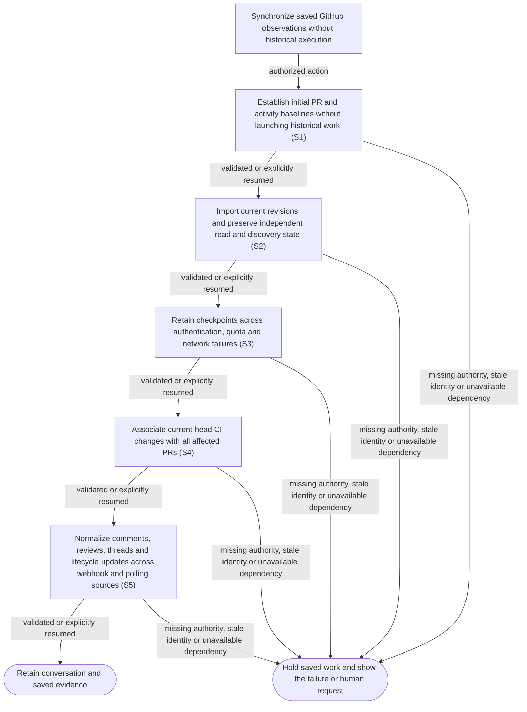

# Synchronize saved GitHub observations without historical execution

## Goal

Synchronize saved GitHub observations without historical execution.

## Preconditions

The private owner connection is established. Application data starts clean in the session-state database; native Codex authentication and configuration remain outside application state. GitHub source text is task data, not new authority.

## Main flow

1. Establish initial PR and activity baselines without launching historical work.

2. Import current revisions and preserve independent read and discovery state.

3. Retain checkpoints across authentication, quota and network failures. Manual scans and background synchronization share a persistent rolling-hour allowance of 2,000 request attempts by default; an explicitly configured allowance takes precedence.

4. Associate current-head CI changes with all affected PRs.

5. Normalize comments, reviews, threads and lifecycle updates across webhook and polling sources.

## Alternatives and recovery

Automatic repository scans and saved detail refreshes follow their separate saved
intervals; review notifications keep their own cadence even while repository scans
remain due. After a successful automatic repository scan, overdue notifications
are polled without waiting for an idle repository cycle. Increasing an interval defers
the corresponding upstream reads, while shortening detail freshness also expires
older cached metadata. Explicit synchronization remains available, and source reads
that require live validation bypass detail freshness. Legacy settings retain the
existing polling intervals.

Read-only inspection does not launch a model turn. Surface validation or provider errors and retain saved work. Human questions, explicit interruptions and uncertain deliveries hold automatic dispatch. Resume against current retained history; never replay an uncertain send or an answered RPC blindly. Explicit cleanup preserves dirty worktrees. A busy conversation defers only its own ingestion; polling continues discovering independent changes in the same repository and other repositories, including their quiet deadlines. Deferred baseline observations stay historical, deferred webhooks remain durable without artificial failure backoff, and cancellation stops the poll. Changed webhook source commits a metadata-only inbox notification; redelivery and unchanged source do not create extra notifications.

## Scenarios

- **S1** — Establish initial PR and activity baselines without launching historical work.
- **S2** — Import current revisions and preserve independent read and discovery state.
- **S3** — Retain checkpoints across authentication, quota and network failures.
- **S4** — Associate current-head CI changes with all affected PRs.
- **S5** — Normalize comments, reviews, threads and lifecycle updates across webhook and polling sources.

## Verification scope

The assertion references below establish their fixture scope. Native installed-host, real-provider and assistive-technology acceptance require separate dated observations. The retired pipeline editor, review artifacts, AI question repair and built-in issue-report ledger have no compatibility path.

<!-- flow-references -->
## Terminology and UI references

Glossary: [normalized-event](../glossary/README.md#normalized-event), [repository](../glossary/README.md#repository), [work-item](../glossary/README.md#work-item).
UI entities: [PAGE-INBOX](../ui/README.md#PAGE-INBOX), [W-ITEM-ROW](../ui/README.md#W-ITEM-ROW), [W-EVENT-BATCHES](../ui/README.md#W-EVENT-BATCHES).

## Flow diagram

## Implementation references

- [internal/factory/github.go](../../internal/factory/github.go) — Durable webhook/poll normalization with initial baseline and CI association. (`func (s *Service) Poll(`)
- [internal/app/app.go](../../internal/app/app.go) — Retained revision-aware triage, priority precedence and relationships. (`func (a *App) UserAction(`)
- [internal/providers/pull_requests.go](../../internal/providers/pull_requests.go) — Complete current-head GraphQL review requests, lifecycle and thread observations. (`func (g *GitHub) EnrichPullRequest(`)
- [internal/transport/factory.go](../../internal/transport/factory.go) — Session, configuration, event and retained triage APIs. (`func NewFactory(`)
- [internal/providers/github_usage.go](../../internal/providers/github_usage.go) — Current sync-inbox implementation or fixture/build dependency.
- [internal/providers/github_notifications.go](../../internal/providers/github_notifications.go) — Current sync-inbox implementation or fixture/build dependency.
- [internal/providers/jira.go](../../internal/providers/jira.go) — Current sync-inbox implementation or fixture/build dependency.
- [internal/providers/github_cache.go](../../internal/providers/github_cache.go) — Current sync-inbox implementation or fixture/build dependency.
- [internal/providers/github_source.go](../../internal/providers/github_source.go) — Current sync-inbox implementation or fixture/build dependency.
- [internal/providers/github_requests.go](../../internal/providers/github_requests.go) — Current sync-inbox implementation or fixture/build dependency.
- [internal/providers/github_reviews.go](../../internal/providers/github_reviews.go) — Current sync-inbox implementation or fixture/build dependency.
- [internal/providers/continuation.go](../../internal/providers/continuation.go) — Current sync-inbox implementation or fixture/build dependency.
- [internal/providers/github.go](../../internal/providers/github.go) — Current sync-inbox implementation or fixture/build dependency.

## Test references

- [internal/factory/service_test.go](../../internal/factory/service_test.go) — `func TestBaselineAndPollingOverlap(`; S1, S2. Baseline observations launch no work; overlapping webhook/poll observations deduplicate.
- [internal/factory/service_test.go](../../internal/factory/service_test.go) — `func TestWebhookSignaturePersistenceRedelivery(`; S3, S5. Invalid HMAC is rejected, valid delivery persists before202, redelivery stays singular, and signed same-ID different body or event type returns503 without replacing the original ledger.
- [internal/factory/service_test.go](../../internal/factory/service_test.go) — `func TestCIWebhookAssociatesEveryCurrentHeadPRAndPollDeduplicates(`; S4. CI result refresh reaches every PR at the current SHA; overlapping poll emits no duplicate.
- [internal/providers/pull_requests_test.go](../../internal/providers/pull_requests_test.go) — `func TestPullRequestMetadataPaginationCurrentHeadAndRevision(`; S1. Current sync-inbox fixture assertion TestPullRequestMetadataPaginationCurrentHeadAndRevision. Inspect its exact assertion scope.
- [internal/providers/pull_requests_test.go](../../internal/providers/pull_requests_test.go) — `func TestPullRequestMetadataRateLimitBackoff(`; S1. Current sync-inbox fixture assertion TestPullRequestMetadataRateLimitBackoff. Inspect its exact assertion scope.
- [internal/providers/pull_requests_test.go](../../internal/providers/pull_requests_test.go) — `func TestUnprotectedPRReviewFallbackFollowsEveryOpinionPage(`; S1. Current sync-inbox fixture assertion TestUnprotectedPRReviewFallbackFollowsEveryOpinionPage. Inspect its exact assertion scope.
- [internal/providers/github_cache_bounds_test.go](../../internal/providers/github_cache_bounds_test.go) — `func TestGitHubPersistentCacheAccountingPreservesLegacyEntriesAndReplacement(`; S1. Current sync-inbox fixture assertion TestGitHubPersistentCacheAccountingPreservesLegacyEntriesAndReplacement. Inspect its exact assertion scope.
- [internal/providers/github_reviews_test.go](../../internal/providers/github_reviews_test.go) — `func TestPublishedReviewsKeepVerdictCommitAndPaginatedInlineEvidence(`; S1. Current sync-inbox fixture assertion TestPublishedReviewsKeepVerdictCommitAndPaginatedInlineEvidence. Inspect its exact assertion scope.
- [internal/providers/github_reviews_test.go](../../internal/providers/github_reviews_test.go) — `func TestPublishedReviewCacheRetainsActualProviderObservationTime(`; S1. Current sync-inbox fixture assertion TestPublishedReviewCacheRetainsActualProviderObservationTime. Inspect its exact assertion scope.
- [internal/providers/github_cache_test.go](../../internal/providers/github_cache_test.go) — `func TestGitHubCacheExpiryInvalidationLiveWriteThroughAndRestart(`; S1. Current sync-inbox fixture assertion TestGitHubCacheExpiryInvalidationLiveWriteThroughAndRestart. Inspect its exact assertion scope.
- [internal/providers/github_cache_test.go](../../internal/providers/github_cache_test.go) — `func TestGitHubCacheLiveFailureNeverFallsBackAndHitsDoNotWaitForNetwork(`; S1. Current sync-inbox fixture assertion TestGitHubCacheLiveFailureNeverFallsBackAndHitsDoNotWaitForNetwork. Inspect its exact assertion scope.
- [internal/providers/github_cache_test.go](../../internal/providers/github_cache_test.go) — `func TestGitHubCacheDirectGraphReadUpdatesSharedHTTPState(`; S1. Current sync-inbox fixture assertion TestGitHubCacheDirectGraphReadUpdatesSharedHTTPState. Inspect its exact assertion scope.
- [internal/providers/github_cache_test.go](../../internal/providers/github_cache_test.go) — `func TestGitHubCacheNewHeadOrUpdateCannotReuseOldDetail(`; S1. Current sync-inbox fixture assertion TestGitHubCacheNewHeadOrUpdateCannotReuseOldDetail. Inspect its exact assertion scope.
- [internal/providers/github_cache_test.go](../../internal/providers/github_cache_test.go) — `func TestGitHubCachePreservesSummarySemanticsCopiesAndRelatedInvalidation(`; S1. Current sync-inbox fixture assertion TestGitHubCachePreservesSummarySemanticsCopiesAndRelatedInvalidation. Inspect its exact assertion scope.
- [internal/providers/work_queues_test.go](../../internal/providers/work_queues_test.go) — `func TestReviewRequestsRefreshWithoutIssueTimestampChange(`; S1. Current sync-inbox fixture assertion TestReviewRequestsRefreshWithoutIssueTimestampChange. Inspect its exact assertion scope.
- [internal/providers/work_queues_test.go](../../internal/providers/work_queues_test.go) — `func TestGitHubTeamMembershipPaginationAndFailure(`; S1. Current sync-inbox fixture assertion TestGitHubTeamMembershipPaginationAndFailure. Inspect its exact assertion scope.
- [internal/providers/github_usage_test.go](../../internal/providers/github_usage_test.go) — `func TestManagedTransportsShareProcessGateAndPreserveCooldown(`; S1. Current sync-inbox fixture assertion TestManagedTransportsShareProcessGateAndPreserveCooldown. Inspect its exact assertion scope.
- [internal/providers/github_usage_test.go](../../internal/providers/github_usage_test.go) — `func TestGitHubSharedBudgetSurvivesRestartSerializesAndFailsClosed(`; S1. Current sync-inbox fixture assertion TestGitHubSharedBudgetSurvivesRestartSerializesAndFailsClosed. Inspect its exact assertion scope.
- [internal/providers/github_usage_test.go](../../internal/providers/github_usage_test.go) — `func TestGitHubPersistentConditionalCacheAuthIsolationAnd304RateObservation(`; S1. Current sync-inbox fixture assertion TestGitHubPersistentConditionalCacheAuthIsolationAnd304RateObservation. Inspect its exact assertion scope.
- [internal/providers/github_usage_test.go](../../internal/providers/github_usage_test.go) — `func TestGitHubSecondaryCooldownBlocksRESTAndGraphQLAcrossRestart(`; S1. Current sync-inbox fixture assertion TestGitHubSecondaryCooldownBlocksRESTAndGraphQLAcrossRestart. Inspect its exact assertion scope.
- [internal/providers/github_usage_test.go](../../internal/providers/github_usage_test.go) — `func TestIndexCallCountDoesNotGrowWithPRHistory(`; S1. Current sync-inbox fixture assertion TestIndexCallCountDoesNotGrowWithPRHistory. Inspect its exact assertion scope.
- [internal/providers/github_usage_test.go](../../internal/providers/github_usage_test.go) — `func TestNotificationConditionalReadsHonorPollIntervalAcrossCursorChanges(`; S1. Current sync-inbox fixture assertion TestNotificationConditionalReadsHonorPollIntervalAcrossCursorChanges. Inspect its exact assertion scope.
- [internal/providers/github_usage_test.go](../../internal/providers/github_usage_test.go) — `func TestGitHubRedirectsAreBudgetedAndNeverForwardAuthenticationOffOrigin(`; S1. Current sync-inbox fixture assertion TestGitHubRedirectsAreBudgetedAndNeverForwardAuthenticationOffOrigin. Inspect its exact assertion scope.
- [internal/providers/github_usage_test.go](../../internal/providers/github_usage_test.go) — `func TestRateHeadersStopRequestsEvenWhenErrorBodyIsTruncated(`; S1. Current sync-inbox fixture assertion TestRateHeadersStopRequestsEvenWhenErrorBodyIsTruncated. Inspect its exact assertion scope.
- [internal/providers/github_usage_test.go](../../internal/providers/github_usage_test.go) — `func TestEmptyLocalCredentialCannotFallBackToAnonymousAPI(`; S1. Current sync-inbox fixture assertion TestEmptyLocalCredentialCannotFallBackToAnonymousAPI. Inspect its exact assertion scope.
- [internal/providers/github_requests_test.go](../../internal/providers/github_requests_test.go) — `func TestInboxRequestBudgetAndIndependentFreshness(`; S1. Current sync-inbox fixture assertion TestInboxRequestBudgetAndIndependentFreshness. Inspect its exact assertion scope.
- [internal/providers/github_requests_test.go](../../internal/providers/github_requests_test.go) — `func TestSharedCacheLRUAccountingAndExpiry(`; S1. Current sync-inbox fixture assertion TestSharedCacheLRUAccountingAndExpiry. Inspect its exact assertion scope.
- [internal/providers/github_requests_test.go](../../internal/providers/github_requests_test.go) — `func TestSharedOperationCacheAuthenticationAndSerialization(`; S1. Current sync-inbox fixture assertion TestSharedOperationCacheAuthenticationAndSerialization. Inspect its exact assertion scope.
- [internal/providers/github_requests_test.go](../../internal/providers/github_requests_test.go) — `func TestSharedPersistedCooldownAndPagination(`; S1. Current sync-inbox fixture assertion TestSharedPersistedCooldownAndPagination. Inspect its exact assertion scope.
- [internal/providers/github_requests_test.go](../../internal/providers/github_requests_test.go) — `func TestCheckRunLinksCompletenessAndIncrementalExpiry(`; S1. Current sync-inbox fixture assertion TestCheckRunLinksCompletenessAndIncrementalExpiry. Inspect its exact assertion scope.
- [internal/providers/github_test.go](../../internal/providers/github_test.go) — `func TestGitHubPaginationPREnrichmentAndRecovery(`; S1. Current sync-inbox fixture assertion TestGitHubPaginationPREnrichmentAndRecovery. Inspect its exact assertion scope.
- [internal/providers/github_test.go](../../internal/providers/github_test.go) — `func TestGitHubRateLimitsRevocationAndPaginationOrigin(`; S1. Current sync-inbox fixture assertion TestGitHubRateLimitsRevocationAndPaginationOrigin. Inspect its exact assertion scope.
- [internal/providers/github_test.go](../../internal/providers/github_test.go) — `func TestConditionalCacheKeepsPaginationAndScopesAuthentication(`; S1. Current sync-inbox fixture assertion TestConditionalCacheKeepsPaginationAndScopesAuthentication. Inspect its exact assertion scope.
- [internal/providers/github_test.go](../../internal/providers/github_test.go) — `func TestSyncEnrichmentSerializesRequestsAndCancelsOnFailure(`; S1. Current sync-inbox fixture assertion TestSyncEnrichmentSerializesRequestsAndCancelsOnFailure. Inspect its exact assertion scope.
- [internal/providers/continuation_test.go](../../internal/providers/continuation_test.go) — `func TestCurrentWorkItemRevalidatesCachedLifecycleAndFailsClosed(`; S1. Current sync-inbox fixture assertion TestCurrentWorkItemRevalidatesCachedLifecycleAndFailsClosed. Inspect its exact assertion scope.
- [internal/factory/service_test.go](../../internal/factory/service_test.go) — `func TestInitialDetailedImportBaselinesHistoryAndLaterThreadChanges(`; S1, S5. Actual Poll baselines detailed historical comments/threads and deduplicates a later resolved thread.
- [internal/app/app_test.go](../../internal/app/app_test.go) — `func TestSharedGitHubCooldownPreservesInboxCheckpoints(`; S3. Budgeted source synchronization preserves exact checkpoints during shared GitHub cooldown.
- [internal/app/app_test.go](../../internal/app/app_test.go) — `func TestScheduledSyncRecoversCredentialsAndFindsNewItems(`; S2, S3. Scheduled sync recovers credentials and observes newly discovered source items without losing baseline state.
- [internal/factory/service_test.go](../../internal/factory/service_test.go) — `func TestDiscussionWebhooksKeepNewerPRContext(`; S2. Late review, inline-comment and thread webhook snapshots retain newer saved PR head, title and labels in both saved state and normalized event context.
- [internal/factory/regressions_test.go](../../internal/factory/regressions_test.go) — `func TestCommentDeletionNormalizesOnceAcrossWebhookAndPolling(`; S5. Discussion and inline-comment deletion normalize once through both webhook and poll despite unchanged body/timestamp and redelivery.
- [internal/factory/regressions_test.go](../../internal/factory/regressions_test.go) — `func TestDetailRefreshAdvancesPastSkippedAndFailedItems(`; S2. Detail cursor advances past paused, removed and failed rows to refresh the later eligible item while preserving the failure.
- [internal/factory/regressions_test.go](../../internal/factory/regressions_test.go) — `func TestInitialDetailBaselineCannotLaunchUnprocessedHistory(`; S1. Multiple initial detail pages establish historical comments as baseline without starting sessions.
- [internal/factory/regressions_test.go](../../internal/factory/regressions_test.go) — `func TestPollReadsOnlyDuePendingDeliveries(`; S5. Polling selects due unprocessed webhook rows without decoding processed archives or future pending deliveries.
- [internal/factory/regressions_test.go](../../internal/factory/regressions_test.go) — `func TestCIRefreshPreservesDiscussionWhenProviderReturnsEmptyActivity(`; S4. Four CI webhook types preserve saved discussion when provider activity is empty; queued events contain compact context and the delivered batch contains full current discussion once.
- [internal/factory/regressions_test.go](../../internal/factory/regressions_test.go) — `func TestPollFirstWebhookEnrichesActionsWithoutDuplicateRules(`; S5. Poll-first request/comment-created/comment-edited observations are enriched by later webhook actions once, with one canonical event, ordered specific rules and no repeated general rule before or after prior delivery.
- [internal/store/factory_reads_test.go](../../internal/store/factory_reads_test.go) — `func TestDueRecordsCompareInstantsAcrossTimezones(`; S3. Due-record selection includes a past positive-offset timestamp and excludes a future negative-offset timestamp by comparing instants.
- [internal/factory/regressions_test.go](../../internal/factory/regressions_test.go) — `func TestWebhookLifecycleReturningToBaselineStillRunsOnce(`; S1, S5. A received reopened webhook matching an initial open baseline still creates one authorized action; redelivery and overlapping polling do not repeat it.
- [internal/factory/regressions_test.go](../../internal/factory/regressions_test.go) — `func TestReviewThreadWebhooksUseActionWithoutInventedResolvedField(`; S5. Resolved and unresolved webhooks use top-level action and node_id without invented is_resolved; saved state changes and each transition queues once across redelivery/polling.
- [internal/factory/regressions_test.go](../../internal/factory/regressions_test.go) — `func TestReviewStateCasingDeduplicatesActualRESTAndWebhookOverlap(`; S5. Actual REST uppercase review state and lowercase webhook normalize identically in either order, producing one action without resetting the quiet deadline.
- [internal/factory/regressions_test.go](../../internal/factory/regressions_test.go) — `func TestCachedDetailCannotReverseNewerWebhookObservation(`; S2, S5. A cached older detail snapshot cannot reverse a newer resolved webhook or queue a false reverse action; a genuinely later unresolved snapshot remains observable.
- [internal/factory/regressions_test.go](../../internal/factory/regressions_test.go) — `func TestCommentCatchupStoresLinearDeltasAndWritesQueueOnce(`; S5. A catch-up of 100 comments at 4 KiB each performs one SQL session write and keeps aggregate events and the queued session each within 1 MiB; a selected comment marker occurs exactly twice in the delivered batch and actual native input.
- [internal/factory/regressions_test.go](../../internal/factory/regressions_test.go) — `func TestDelayedCommentWebhookCannotReverseNewerActivity(`; S5. Older timezone-aware discussion/inline-comment webhook versions cannot replace retained B or cause poll duplication; genuinely newer C is saved and authorizes one action.
- [internal/factory/review7_test.go](../../internal/factory/review7_test.go) — `func TestSignedWebhookCommitsInboxNotificationWithoutProviderRead(`; S2, S5. A signed webhook persists changed PR source and emits one metadata-only inbox.changed subscription for matching and absent rules, without private body/native turn. Redelivery and same-source new delivery emit no extra notification.
- [internal/factory/review7_test.go](../../internal/factory/review7_test.go) — `func TestPollingDiscoversPeerChangesWhileNativeAttachmentIsHeld(`; S1, S2, S5. Five held-attachment modes cover unchanged issue, changed PR, detail refresh, initial baseline and busy webhook. Actual Poll discovers same- and other-repository peer heads and sets their 120-second quiet deadlines before the held attachment releases. Busy webhook remains pending without backoff; canceled Poll stops; release+two polls preserve one deferred head transition/no initial historical queue and no extra native turns.
- [internal/providers/github_transport_cache_test.go](../../internal/providers/github_transport_cache_test.go) — `func TestGitHubRESTTransportsSharePersistentCacheAndLiveReads(`; S3. Typed and generic REST share persisted bodies and ETags across restart; forced live reads update both paths, expiry revalidates, copies remain isolated and another credential cannot reuse the result.
- [internal/providers/github_transport_cache_test.go](../../internal/providers/github_transport_cache_test.go) — `func TestGitHubGenericCachePersistsLastModifiedAndNeverMemoizesWrites(`; S3. Restart retains Last-Modified, response body and pagination; 200/304 durable records exclude cookies and private headers while live responses preserve them. Repeated writes dispatch independently while batch GETs memoize and forced live reads bypass the memo.
- [internal/providers/github_transport_cache_test.go](../../internal/providers/github_transport_cache_test.go) — `func TestGitHubGraphCacheSeparatesOriginsAndSurvivesRestart(`; S3. Identical GraphQL queries and credentials at two API origins retain independent results across client restarts.
- [internal/providers/github_transport_cache_test.go](../../internal/providers/github_transport_cache_test.go) — `func TestGitHubRevocationInvalidatesCredentialCacheAcrossTransportsAndRestart(`; S3. A live 401/403 with empty, truncated or oversized body, or a GraphQL FORBIDDEN/UNAUTHORIZED envelope, invalidates the same credential response/query caches across operations and restart in memory/durable modes; another credential retains hits. Mixed auth/rate envelopes in either order, using type and extensions.code, retain rate classification while invalidating; auth with zero remaining quota also invalidates.
- [internal/providers/github_transport_cache_test.go](../../internal/providers/github_transport_cache_test.go) — `func TestGitHubCacheGenerationFailuresCannotReturnCachedSuccess(`; S3. A real SQLite trigger rejecting generation writes blocks subsequent same-client response/query cache hits; malformed persisted generation data fails closed after client restart without contacting GitHub. Mixed GraphQL auth/rate generation-write failure returns cache failure before rate classification and blocks that client query hits.
- [internal/app/github_usage_test.go](../../internal/app/github_usage_test.go) — `func TestGitHubDefaultBudgetAndExplicitOverride(`; S3. Application policy defaults to 2,000 request attempts per hour while retaining an explicit 600-request override.
- [internal/providers/github_usage_test.go](../../internal/providers/github_usage_test.go) — `func TestGitHubDefaultBudgetReportingAndAdmission(`; S3. Default and saved usage report 2,000, preserve explicit overrides and prior attempts, admit request 2,000, and defer request 2,001 until the rolling window frees capacity.
- [internal/app/github_cadence_test.go](../../internal/app/github_cadence_test.go) — `func TestGitHubRepositoryCadenceSuppressesHTTPAndManualSyncRemainsLive(`; S2, S3. A configured hourly repository cadence suppresses all HTTP at twenty minutes; explicit synchronization fetches both lists and identity; a due hourly scan fetches current lists independently of notification timing.
- [internal/app/github_cadence_test.go](../../internal/app/github_cadence_test.go) — `func TestGitHubDetailCadenceSuppressesSelectedItemHTTP(`; S2. Selected issue details perform no HTTP before the configured hour and then fetch source, comments and timeline, retaining the current title and observation timestamp.
- [internal/app/github_cadence_test.go](../../internal/app/github_cadence_test.go) — `func TestGitHubNotificationCadenceRemainsIndependent(`; S2, S3. A ten-minute notification interval suppresses a three-minute poll; lowering only that setting permits notifications while long repository/detail intervals remain configured.
- [internal/app/github_cadence_test.go](../../internal/app/github_cadence_test.go) — `func TestGitHubNotificationCadenceRunsWhileRepositoryScansStayDue(`; S2, S3. Repeated one-minute due repository scans still poll overdue notifications; a fresh ten-minute notification deadline suppresses only notifications, and canceled scheduling performs no upstream work.
- [internal/factory/github_cadence_test.go](../../internal/factory/github_cadence_test.go) — `func TestBackgroundDetailCadenceSuppressesHTTPUntilDue(`; S2, S5. The service clock advances beyond the old fifteen-minute threshold with no HTTP; crossing the configured hourly deadline performs three source/history requests and saves their current observation.
- [internal/providers/github_cadence_test.go](../../internal/providers/github_cadence_test.go) — `func TestGitHubDetailCadenceControlsHTTPQueryCacheAndExplicitLiveReads(`; S2, S3, S4. PR composite cache retains four HTTP responses across twenty minutes under an hourly policy; explicit live reads still dispatch, shortening the interval expires old data immediately, policy errors fail closed, and lifecycle validation remains live.
- [internal/providers/github_cadence_test.go](../../internal/providers/github_cadence_test.go) — `func TestGitHubDetailCadenceControlsGraphQLCacheAfterSettingChanges(`; S2, S3, S4. GraphQL metadata remains cached beyond fifteen minutes under an hourly policy, shortening the policy causes a new request, and RequireLive bypasses the configured interval.
- [internal/app/github_cadence_test.go](../../internal/app/github_cadence_test.go) — `func TestGitHubReferencedPRCadenceSuppressesHTTPUntilDue(`; S2, S4. A retained manually referenced PR produces no upstream reads at twenty minutes with an hourly detail interval, then four authoritative reads after the deadline and a retained successful CI observation.

## Verification and gaps

Local suites: `go`, `browser`.
Fixture success does not establish real-host acceptance.

<!-- /flow-references -->
