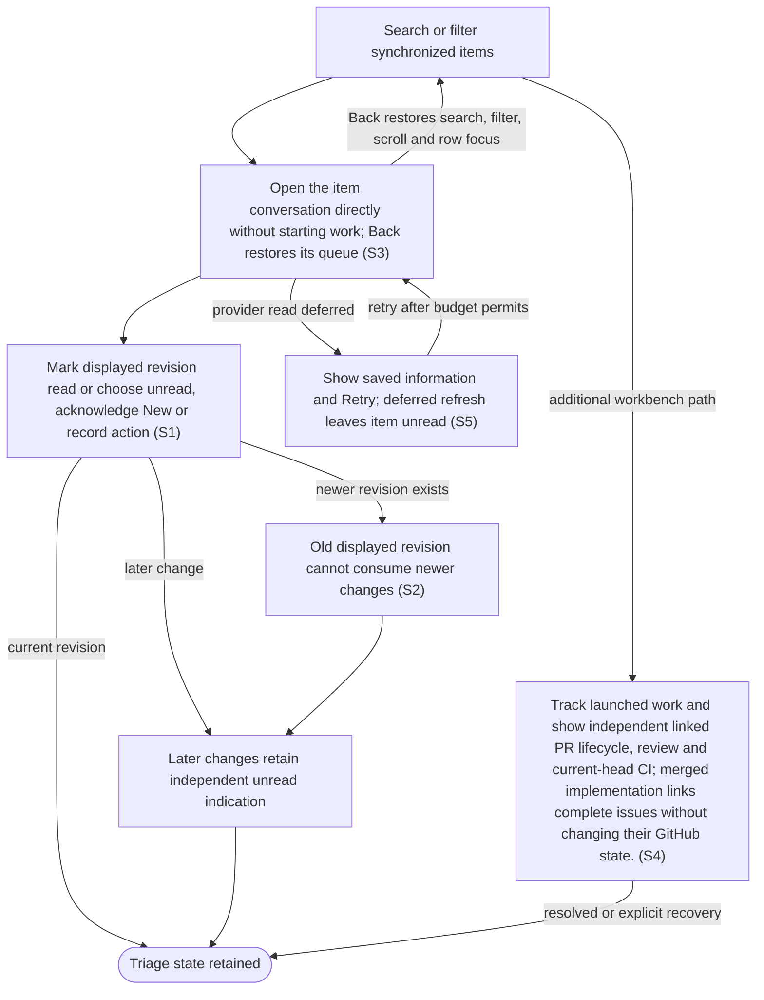

# Browse and triage the inbox

## Goal

The owner finds relevant items and tracks what is new, unread and already acted on independently.

## Preconditions

At least one repository has synchronized items.

## Main flow

1. Open Issues, defaulting to open issues including those with linked pull requests, sorted by priority with unknown priorities last. My PRs shows open pull requests authored by the authenticated account; Review PRs shows open requests to that account or its teams. Each tab retains its own search and filters. No matches offers Clear filters. Repository/number links open the original source independently.
2. Select an item to open its conversation immediately with item information and a source-description summary. Continue the newest retained run or see a prefilled editable first message; the list is replaced. Full description, activity, priority, checks and relationships are in Item details below chat. Dashboard refreshes carry summaries; full activity and raw checks are fetched only for the selected item.
3. Mark the displayed version read, or use Actions to mark unread, acknowledge New or record an action.
4. Continue receiving unread indications for later changes even after earlier actions.

## Alternatives and recovery

Listing items and opening their external GitHub links do not mark them read. A failed or denied external link leaves the list active with visible feedback. A read action for an older displayed version does not consume newer changes. Opening an item never prepares or starts an agent. Transient detail reads retry and only a successfully displayed revision is marked read. Tool/business errors remain local and require explicit retry; stale read responses cannot replace a later selection. Existing retained work opens directly. New run remains available under Item details for a separate customized proposal. Reading on the provider website is not inferred. Successful item actions refresh visible detail/history while preserving independent drafts; a late response cannot replace a later selection. Relationship drafts stay with their item across item and tab switches; the priority picker reflects the saved override. Routine sync times are omitted, nonempty history and less frequent controls are disclosed, and failures remain visible. Back restores the inbox list’s search/filter, scroll position and row focus when that row still exists. Each work-tab navigation opens its list; no empty detail pane remains. Identity and team-membership failures remain visible rather than guessing ownership.

## Scenarios

- **S1** Initial unread, New and action history remain independent.
- **S2** Marking an old displayed version read leaves a newer version unread.
- **S3** Focused queues apply pending/author/reviewer membership and priority order. Selecting an item opens its conversation with context; Back restores that queue. Listing, source links and selection never start work.

- **S4** Track launched work and show independent linked PR lifecycle, review and current-head CI; merged implementation links complete issues without changing their GitHub state.

- **S5** When a provider refresh is deferred, saved item details remain visible with an explicit Retry action. The item is not marked read until a successful refresh can present its displayed version; retrying never launches work.

<!-- flow-references -->
## Terminology and UI references

Glossary: [inbox](../glossary/README.md#inbox), [work-item](../glossary/README.md#work-item), [state-new](../glossary/README.md#state-new), [state-unread](../glossary/README.md#state-unread), [state-acted-on](../glossary/README.md#state-acted-on), [coverage-gap](../glossary/README.md#coverage-gap), [unverified-behavior](../glossary/README.md#unverified-behavior), [working-queue](../glossary/README.md#working-queue), [implementation-relationship](../glossary/README.md#implementation-relationship).
UI entities: [PAGE-INBOX](../ui/README.md#PAGE-INBOX), [P-INBOX-QUERY](../ui/README.md#P-INBOX-QUERY), [P-INBOX-LIST](../ui/README.md#P-INBOX-LIST), [P-ITEM-DETAIL](../ui/README.md#P-ITEM-DETAIL), [W-INBOX-QUERY](../ui/README.md#W-INBOX-QUERY), [W-SYNC-HEALTH](../ui/README.md#W-SYNC-HEALTH), [W-ITEM-ROW](../ui/README.md#W-ITEM-ROW), [W-INBOX-EMPTY](../ui/README.md#W-INBOX-EMPTY), [W-ITEM-OVERVIEW](../ui/README.md#W-ITEM-OVERVIEW), [W-ITEM-ACTIONS](../ui/README.md#W-ITEM-ACTIONS), [W-ITEM-HISTORY](../ui/README.md#W-ITEM-HISTORY), [C-FILTER](../ui/README.md#C-FILTER), [C-SELECT-ITEM](../ui/README.md#C-SELECT-ITEM), [C-ITEM-STATE](../ui/README.md#C-ITEM-STATE), [PAGE-AGENT](../ui/README.md#PAGE-AGENT), [C-BACK](../ui/README.md#C-BACK), [C-ITEM-SOURCE](../ui/README.md#C-ITEM-SOURCE), [PAGE-MY-PRS](../ui/README.md#PAGE-MY-PRS), [PAGE-REVIEW-PRS](../ui/README.md#PAGE-REVIEW-PRS), [W-NEW-CHAT](../ui/README.md#W-NEW-CHAT), [C-START-CHAT](../ui/README.md#C-START-CHAT), [PAGE-WORKING](../ui/README.md#PAGE-WORKING), [W-PR-EVIDENCE](../ui/README.md#W-PR-EVIDENCE).

## Flow diagram

## Implementation references

- [internal/app/app.go](../../internal/app/app.go) — Inbox sorting and independent user state (`func (a *App) UserAction(`)
- [web/src/main.tsx](../../web/src/main.tsx) — Inbox filters and revision-aware detail (`function ItemDetail(`)
- [internal/transport/mcp.go](../../internal/transport/mcp.go) — Separate listing, detail and state-changing operations
- [internal/domain/types.go](../../internal/domain/types.go) — Shared domain, persistence, transport or dependency contract
- [internal/store/store.go](../../internal/store/store.go) — Shared domain, persistence, transport or dependency contract
- [go.mod](../../go.mod) — Shared domain, persistence, transport or dependency contract
- [go.sum](../../go.sum) — Shared domain, persistence, transport or dependency contract
- [web/src/types.ts](../../web/src/types.ts) — Embedded UI build and host-fixture configuration
- [web/src/style.css](../../web/src/style.css) — Embedded UI build and host-fixture configuration
- [web/src/bridge.ts](../../web/src/bridge.ts) — Embedded UI build and host-fixture configuration
- [web/package.json](../../web/package.json) — Embedded UI build and host-fixture configuration
- [web/package-lock.json](../../web/package-lock.json) — Embedded UI build and host-fixture configuration
- [web/tsconfig.json](../../web/tsconfig.json) — Embedded UI build and host-fixture configuration
- [web/vite.config.ts](../../web/vite.config.ts) — Embedded UI build and host-fixture configuration
- [web/index.html](../../web/index.html) — Embedded UI build and host-fixture configuration
- [web/playwright.config.ts](../../web/playwright.config.ts) — Embedded UI build and host-fixture configuration
- [internal/testhost/main.go](../../internal/testhost/main.go) — Embedded UI build and host-fixture configuration
- [internal/testutil/fakecodex/main.go](../../internal/testutil/fakecodex/main.go) — Embedded UI build and host-fixture configuration
- [internal/testutil/testutil.go](../../internal/testutil/testutil.go) — Embedded UI build and host-fixture configuration
- [internal/web/embed.go](../../internal/web/embed.go) — Embedded UI build and host-fixture configuration
- [internal/app/work.go](../../internal/app/work.go) — Server queue membership and linked PR/work projections. (`func (a *App) projectWork(`)

## Test references

- [internal/app/app_test.go](../../internal/app/app_test.go) — `func TestInboxRevisionStatesPriorityAndLinks(`; S1, S2. Baseline, later revisions and independent action history.
- [web/tests/factory.spec.ts](../../web/tests/factory.spec.ts) — `test("triage does not launch, launch edits and attention answer survive reopening"`; S3. Opening detail does not call prepare/start.
- [internal/transport/mcp_test.go](../../internal/transport/mcp_test.go) — `func TestAuthenticatedMCPDiscoveryToolsAndUI(`; S3. Read tools and app-only visibility are exercised.
- [web/tests/factory.spec.ts](../../web/tests/factory.spec.ts) — `test("item actions refresh visible history while unread, New and drafts remain independent"`; S1, S3. Action history refreshes immediately; Mark unread and acknowledge New remain independent, drafts survive and refresh sends no extra read or launch.
- [web/tests/factory.spec.ts](../../web/tests/factory.spec.ts) — `test("a delayed relationship refresh cannot replace a later selection or its drafts"`; S3. A held earlier relationship detail response cannot replace a later selected item or its independent drafts.
- [web/tests/factory.spec.ts](../../web/tests/factory.spec.ts) — `test("empty filtered inbox offers Clear filters and hides zero attention"`; S3. No matching items and Clear filters recover the visible list without launching.
- [web/tests/factory.spec.ts](../../web/tests/factory.spec.ts) — `test("item switching restores saved priorities and keeps relationship drafts by item"`; S1, S3. Saved priorities and per-item link drafts survive selection/tab changes without state leakage.
- [web/tests/factory.spec.ts](../../web/tests/factory.spec.ts) — `single-page navigation preserves list context and drafts at`; S1. Both themes and 1280px/390px widths assert exclusive list/item/agent pages, Back focus/scroll/query restoration and per-record draft preservation.
- [web/tests/factory.spec.ts](../../web/tests/factory.spec.ts) — `page changes keep keyboard focus usable when an unread row leaves the list`; S1, S3. A read item disappears from the unread list; Back and Clear filters recover without an empty detail panel.
- [web/tests/factory.spec.ts](../../web/tests/factory.spec.ts) — `small inbox GitHub links open the original issue and PR without selecting either`; S3. Original issue and pull request links use the host browser, preserve unread/New and keep the list active; row selection stays independent.
- [web/tests/factory.spec.ts](../../web/tests/factory.spec.ts) — `inbox GitHub link ${failure} failure stays in the list with visible feedback`; S3. Host rejection/failure is visible without marking an item read.
- [web/tests/factory.spec.ts](../../web/tests/factory.spec.ts) — `focused work queues use GitHub ownership review requests and pending priority`; S3. Both themes at 390px assert default open unlinked issue membership, P0-first/unknown-last ordering, author and individual/team review membership, independent filters/search, no launch/read on listing, no overflow and scoped Axe.
- [web/tests/factory.spec.ts](../../web/tests/factory.spec.ts) — `item opens a prefilled conversation and first-message Start stays explicit`; S3. Item opens Agent with summary, prefilled prompt and closed details; no intermediate item-only page or Open agent control, no work before Start, retained item draft, exact prepare/start payload and conversation afterward.
- [internal/app/work_queues_test.go](../../internal/app/work_queues_test.go) — `func TestInboxDetectsPullRequestsInBothDirectionsAndExternalEvidence(`; S3. Known forward/reverse PR links and explicit external PR evidence mark issue membership; removal clears it.
- [web/tests/factory.spec.ts](../../web/tests/factory.spec.ts) — `transient item read failure retries and marks only the successfully displayed revision read`; S3. Three failed item requests retry locally; only the recovered displayed revision is marked read, once.
- [web/tests/factory.spec.ts](../../web/tests/factory.spec.ts) — `read tool errors are not mistaken for retryable transport errors`; S3. Tool-result errors containing Connection failed are not transport failures: item read is attempted once and explicit Retry remains.
- [internal/app/work_tracking_test.go](../../internal/app/work_tracking_test.go) — `func TestWorkingTracksSessionsUntilGitHubCompletion(`; S4. Working completion follows explicit implementation links; references do not complete an issue.
- [web/tests/factory.spec.ts](../../web/tests/factory.spec.ts) — `Working and linked PR monitoring follow server projections`; S4. Both narrow themes consume server membership and linked summaries, preserve source links and remove merged work without launch.
- [internal/transport/mcp_test.go](../../internal/transport/mcp_test.go) — `func TestDashboardSummariesOmitHistoryAndKeepFullItemDetail(`; S3. Megabyte item history and own/linked check lists are absent from the shared snapshot; reviewer membership, body, head and revision remain, and selected-item reads retain exact full content.
- [web/tests/factory.spec.ts](../../web/tests/factory.spec.ts) — `review queues from multiple repositories load full details from compact snapshots`; S3. Both narrow themes display requested PRs from two repositories using compact summaries and fetch full activity/checks only after selection without preparing or starting work.
- [web/tests/factory.spec.ts](../../web/tests/factory.spec.ts) — `a deferred detail refresh retains saved information and unread state until a successful retry`; S2, S5. Cached information remains available; deferred refresh does not mark read before explicit successful retry.
- [internal/app/github_usage_test.go](../../internal/app/github_usage_test.go) — `func TestIndexPreservesHistoryInvalidatesChangedHeadAndBudgetEditsKeepAssessmentPolicy(`; S3, S5. Cheap index preserves full history and cannot reuse current-head status for a changed PR head.
- [web/tests/factory.spec.ts](../../web/tests/factory.spec.ts) — `linked PR changes refresh full selected details without consuming another read or launch`; S3, S4. Latest linked PR metadata refreshes selected full detail without replaying read or launch actions.

## Verification and gaps

Local suites: `go`, `browser`.
Fixture success does not establish real-host acceptance.
- **S1** — `gap-flow-triage-inbox-s1-01` · Unverified behavior · P2 · owner: user-flow-maintainer. Acknowledge/read/New/action-history independence now has a local browser fixture. Each filter combination and the complete installed-host matrix remain unverified. Next verification: Assert each filter combination and record the current installed-host New/unread/action matrix.

<!-- /flow-references -->
