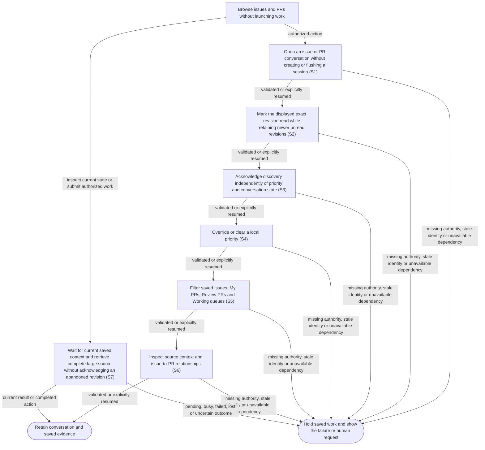

# Browse issues and PRs without launching work

## Goal

Browse issues and PRs without launching work.

## Preconditions

The private owner connection is established. Application data starts clean in the session-state database; native Codex authentication and configuration remain outside application state. GitHub source text is task data, not new authority.

## Main flow

1. Open an issue or PR conversation without creating or flushing a session.

2. Mark the displayed exact revision read while retaining newer unread revisions.

3. Acknowledge discovery independently of priority and conversation state.

4. Override or clear a local priority.

5. Filter saved Issues, My PRs, Review PRs and Working queues.

6. Inspect source context and issue-to-PR relationships.

## Alternatives and recovery

Opening saved item details follows the configured detail freshness interval.
A still-current saved observation avoids an upstream refresh; after the interval,
the selected item refresh retains current source and history without starting work.

Read-only inspection does not launch a model turn. Surface validation or provider errors and retain saved work. Human questions, explicit interruptions and uncertain deliveries hold automatic dispatch. Resume against current retained history; never replay an uncertain send or an answered RPC blindly. Explicit cleanup preserves dirty worktrees.

Saved content is current only after its required saved revisions are ready. While
the requested revision is preparing, show loading and disable actions needing that
content. Searches include saved source bodies. Large source, configuration and exact
question documents remain complete through versioned parts; never silently discard
functional text. A lost or abandoned detail view does not acknowledge a revision.

## Scenarios

- **S1** — Open an issue or PR conversation without creating or flushing a session.
- **S2** — Mark the displayed exact revision read while retaining newer unread revisions.
- **S3** — Acknowledge discovery independently of priority and conversation state.
- **S4** — Override or clear a local priority.
- **S5** — Filter saved Issues, My PRs, Review PRs and Working queues.
- **S6** — Inspect source context and issue-to-PR relationships.

- **S7** — Wait for current saved context and retrieve complete large source without acknowledging an abandoned revision.

## Verification scope

The assertion references below establish their fixture scope. Native installed-host, real-provider and assistive-technology acceptance require separate dated observations. The retired pipeline editor, review artifacts, AI question repair and built-in issue-report ledger have no compatibility path.

<!-- flow-references -->
## Terminology and UI references

Glossary: [inbox](../glossary/README.md#inbox), [work-item](../glossary/README.md#work-item), [operation-receipt](../glossary/README.md#operation-receipt), [daemon-instance](../glossary/README.md#daemon-instance), [read-projection](../glossary/README.md#read-projection), [document-chunk](../glossary/README.md#document-chunk).
UI entities: [PAGE-INBOX](../ui/README.md#PAGE-INBOX), [PAGE-MY-PRS](../ui/README.md#PAGE-MY-PRS), [PAGE-REVIEW-PRS](../ui/README.md#PAGE-REVIEW-PRS), [PAGE-WORKING](../ui/README.md#PAGE-WORKING), [W-INBOX-QUERY](../ui/README.md#W-INBOX-QUERY), [W-ITEM-OVERVIEW](../ui/README.md#W-ITEM-OVERVIEW), [W-PRIORITY](../ui/README.md#W-PRIORITY), [W-RELATIONSHIPS](../ui/README.md#W-RELATIONSHIPS).

## Flow diagram

## Implementation references

- [internal/app/app.go](../../internal/app/app.go) — Retained revision-aware triage, priority precedence and relationships. (`func (a *App) UserAction(`)
- [web/src/wrapper.tsx](../../web/src/wrapper.tsx) — Saved inbox, session conversation, human input and confirmed configuration. (`function Factory(`)
- [internal/transport/factory.go](../../internal/transport/factory.go) — Session, configuration, event and retained triage APIs. (`func NewFactory(`)
- [internal/app/github_usage.go](../../internal/app/github_usage.go) — Current triage-inbox implementation or fixture/build dependency.
- [internal/app/work.go](../../internal/app/work.go) — Current triage-inbox implementation or fixture/build dependency.
- [internal/transport/factory_projection.go](../../internal/transport/factory_projection.go) — Bounded view-specific bodyless inbox and compact session/question state; source detail and configuration are separate. (`func factoryState(`)
- [internal/transport/projections.go](../../internal/transport/projections.go) — Background immutable snapshot preparation and revision matching; exact large-document chunks. (`func (c *projectionCache) read(`)
- [internal/store/revisions.go](../../internal/store/revisions.go) — Committed dependency revisions isolate unrelated transcript traffic and selected items. (`func (s *Store) Revision(`)
- [internal/store/revisions.go](../../internal/store/revisions.go) — Persistent immutable revision branches share unchanged history and preserve pinned snapshot revisions. (`func (s *Store) publishRevisions(`)

## Test references

- [web/tests/wrapper.spec.ts](../../web/tests/wrapper.spec.ts) — `opening an issue or PR does not create or flush a session`; S1. Opening saved issue and PR detail sends no session mutation.
- [web/tests/wrapper.spec.ts](../../web/tests/wrapper.spec.ts) — `priorities relationships and PR queues remain available`; S3, S4, S5, S6. Acknowledge, unread and recorded actions remain independent; P0 override and clearing, manual link addition/removal and My PRs use explicit controls.
- [internal/app/app_test.go](../../internal/app/app_test.go) — `func TestInboxRevisionStatesPriorityAndLinks(`; S2, S3, S4, S6. Exact displayed revisions, independent discovery, priority and source relationships.
- [internal/app/inbox_reads_test.go](../../internal/app/inbox_reads_test.go) — `func TestInboxBulkReadsPreserveContextKeysAndCurrentRevisions(`; S1. Current triage-inbox fixture assertion TestInboxBulkReadsPreserveContextKeysAndCurrentRevisions. Inspect its exact assertion scope.
- [internal/app/github_usage_test.go](../../internal/app/github_usage_test.go) — `func TestNotificationReviewHintsAreScopedReadOnlyAndRestartSafe(`; S1. Current triage-inbox fixture assertion TestNotificationReviewHintsAreScopedReadOnlyAndRestartSafe. Inspect its exact assertion scope.
- [internal/app/github_usage_test.go](../../internal/app/github_usage_test.go) — `func TestIndexPreservesHistoryInvalidatesChangedHeadAndBudgetEditsKeepAssessmentPolicy(`; S1. Current triage-inbox fixture assertion TestIndexPreservesHistoryInvalidatesChangedHeadAndBudgetEditsKeepAssessmentPolicy. Inspect its exact assertion scope.
- [internal/app/github_usage_test.go](../../internal/app/github_usage_test.go) — `func TestIncidentalReferencesDoNotScanUntilSelectedAndErrorsBackOff(`; S1. Current triage-inbox fixture assertion TestIncidentalReferencesDoNotScanUntilSelectedAndErrorsBackOff. Inspect its exact assertion scope.
- [internal/app/github_usage_test.go](../../internal/app/github_usage_test.go) — `func TestInvalidAPIBudgetCannotOverwriteSavedPolicy(`; S1. Current triage-inbox fixture assertion TestInvalidAPIBudgetCannotOverwriteSavedPolicy. Inspect its exact assertion scope.
- [internal/domain/types_test.go](../../internal/domain/types_test.go) — `func TestItemFreshnessKeepsLegacyContentRevision(`; S1. Current triage-inbox fixture assertion TestItemFreshnessKeepsLegacyContentRevision. Inspect its exact assertion scope.
- [internal/app/inbox_bench_test.go](../../internal/app/inbox_bench_test.go) — `func BenchmarkInboxRetainedHistory(`; S5. Retained saved inbox benchmark; no live provider or installed-host performance claim.
- [web/tests/wrapper.spec.ts](../../web/tests/wrapper.spec.ts) — `failed second selection never pairs old context with new actions`; S1, S2. Rejected detail B clears prior detail A; B title and disabled send prevent actions on mismatched saved context.
- [web/tests/wrapper.spec.ts](../../web/tests/wrapper.spec.ts) — `Back restores the originating query filter and row focus with isolated drafts`; S5. Back restores review queue query/filter and row focus; item message drafts remain independent.
- [web/tests/wrapper.spec.ts](../../web/tests/wrapper.spec.ts) — `search filters and bounded pages apply to the complete saved inbox`; S5. Body-only search reaches beyond the first page; open/all/new/unread filters, empty results, expansion and previous/next preserve bounded complete access.
- [web/tests/wrapper.spec.ts](../../web/tests/wrapper.spec.ts) — `a late query response cannot replace a newer inbox query`; S5. A delayed older query response cannot replace the newer matching inbox results.
- [internal/transport/factory_test.go](../../internal/transport/factory_test.go) — `func TestFactoryStatePagesCompactDataAndExplicitDelivery(`; S1, S5. A thousand large saved sources yield bounded bodyless pages; body search/filter precede paging, queue state is explicit, historical questions/proposals are bounded, and full source requires detail read.
- [web/tests/wrapper.spec.ts](../../web/tests/wrapper.spec.ts) — `same-item source and relationship versions refresh and Back reopens saved detail`; S1, S2, S6. Saved source revision and relationship version changes reload the same selected detail; Back and reopening request fresh detail.
- [web/tests/wrapper.spec.ts](../../web/tests/wrapper.spec.ts) — `reopening a failed same-item selection retries detail without launching work`; S1, S2. Failed same-item detail stays unread; Back and reopening retries detail successfully without session launch.
- [web/tests/wrapper.spec.ts](../../web/tests/wrapper.spec.ts) — `abandoned delayed detail stays unread and accepted detail acknowledges its displayed revision`; S2. The exact abandoned item invocation must finish actual bridge decoding and a two-frame React continuation barrier before checking unread/no acknowledgment/no body/current PR. A later intentional reopen accepts revision v2, acknowledges it once, and clears unread; another completed item cannot satisfy the abandoned-response barrier.
- [web/tests/wrapper.spec.ts](../../web/tests/wrapper.spec.ts) — `a superseded detail version is never displayed or acknowledged`; S2. A detail response newer than its requested projection is rejected until the matching version loads; only revision v2 is acknowledged.
- [web/tests/wrapper.spec.ts](../../web/tests/wrapper.spec.ts) — `boot filter controls hydrate using only supported inbox filters`; S5. Before hydration, boot offers only open/all/new/unread; choosing unread survives hydration in the first API request.
- [internal/transport/factory_test.go](../../internal/transport/factory_test.go) — `func TestFactoryItemReadsRequireDisplayedRevisionAcknowledgmentAndVersions(`; S2. Detail fetch has no read mutation; source and relationship changes alter matching detail versions; stale acknowledgment leaves the current revision unread until its explicit exact acknowledgment.
- [web/tests/wrapper.spec.ts](../../web/tests/wrapper.spec.ts) — `idle state polls use change versions and mutations refresh without losing the view`; S1, S5. Idle polls carry sinceVersion and preserve the accepted view through unchanged responses; saved mutations produce a new view and tab/search transitions omit the old cursor.
- [web/tests/wrapper.spec.ts](../../web/tests/wrapper.spec.ts) — `a delayed state version cannot replace a newer accepted refresh`; S1, S5. After a held older full response is consumed, its first successor poll retains the newer accepted version cursor; current rows remain visible and delayed stale rows stay absent.
- [internal/app/assessment_context_test.go](../../internal/app/assessment_context_test.go) — `func TestAssessmentContextTracksBothRelationshipDirectionsAndRelatedState(`; S4, S6. Both incoming and outgoing relationship addition, related revision and evidence changes affect assessment context; removal restores baseline. Incoming ticket state changes invalidate context, unrelated links do not, and enumeration order is stable.
- [internal/factory/review6_test.go](../../internal/factory/review6_test.go) — `func TestIncomingPriorityRelationshipsInvalidateCacheAndLateToolRecords(`; S4, S6. Incoming relationship add, ticket-state change, evidence change and removal reject stale tool records, invalidate actual InboxSummaries AI priority, and trigger one fresh assessment each. Fresh results cache and all five assessments reuse one native thread; label then manual override precedence starts no extra assessment.
- [web/tests/wrapper.spec.ts](../../web/tests/wrapper.spec.ts) — `inbox source links open GitHub without selecting or reading an item`; S1, S2, S6. Separate issue and PR row links invoke the host with the exact GitHub URL, keep inbox selection/read state unchanged and make no detail, read-acknowledgment or session mutation call.
- [internal/transport/factory_test.go](../../internal/transport/factory_test.go) — `func TestFactoryStateReusesInboxAcrossQueriesAndRefreshesAfterMutation(`; S5. After warming the derived inbox, a raw SQL sentinel makes any repeated full decode fail. Changed filter/page/search/tab and conversation queries still succeed from the retained projection; an ordinary source mutation invalidates the cache and returns the updated title.
- [web/tests/wrapper.spec.ts](../../web/tests/wrapper.spec.ts) — `pending saved revisions hide stale context and disable dependent actions`; S7. Pending revisions hide old source, disable Send and poll again. A held current-detail response permits no new-revision acknowledgment; at the eventual acknowledgment bridge entry the matching new source is already displayed.
- [internal/transport/operations_test.go](../../internal/transport/operations_test.go) — `func TestProjectionCurrentReadsChunksAndUnrelatedTranscript(`; S7. Large Unicode source is reconstructed exactly, old projections cannot claim a newly committed revision, and unrelated transcript output leaves a prepared inbox ready.
- [internal/store/revisions_test.go](../../internal/store/revisions_test.go) — `func TestRevisionSnapshotsMatchSavedDataAcrossCommits(`; S7. A pinned read sees matching old saved data and revision across a newer commit; the live store sees matching new data.
- [internal/store/revisions_test.go](../../internal/store/revisions_test.go) — `func TestTranscriptRevisionAllocationWithRetainedHistory(`; S7. With 200001 retained keys, transcript revision updates allocate under 32 KiB each, preserve pinned revisions and retain every unrelated item/user revision.
- [internal/transport/factory_test.go](../../internal/transport/factory_test.go) — `func TestProjectionReadIdentifiersBoundBeforeCacheAdmission(`; S7. Authenticated read selectors reject1,025 ASCII bytes and1,026 UTF-8 bytes before any projection/operation entry, accept the exact1,024-byte boundary, and reconstruct the entire large source unchanged.
- [internal/transport/factory_test.go](../../internal/transport/factory_test.go) — `func TestProjectionDependencyFailureIsVisibleAndRecoversAfterRepair(`; S7. Cold malformed relationship IDs and malformed source/target endpoints inserted after a useful prepared read report failed with a nonzero saved revision for item detail and conversation state; replacing the record restores current source.
- [internal/transport/factory_test.go](../../internal/transport/factory_test.go) — `func TestRelationshipCASInvalidatesPreparedSelectedReads(`; S7. Warm selected item and conversation reads refresh after relationship CAS insertion and a move touching both old and new endpoints.
- [internal/store/revisions_test.go](../../internal/store/revisions_test.go) — `func TestRelationshipCASEndpointsAdvanceOnlyOnSuccessfulWrites(`; S7. CAS insertion and replacement publish old/new endpoint revisions. Stale and absence-predicate rejections preserve all revisions; unrelated endpoints stay unchanged.
- [internal/app/github_cadence_test.go](../../internal/app/github_cadence_test.go) — `func TestGitHubDetailCadenceSuppressesSelectedItemHTTP(`; S1, S6. A selected issue uses the configured hourly detail freshness: no HTTP at twenty minutes, then source/comment/timeline refresh and current saved title after expiry.

## Verification and gaps

Local suites: `go`, `browser`.
Fixture success does not establish real-host acceptance.
- **S1** — `gap-flow-triage-inbox-s1-01` · Unverified behavior · P2 · owner: user-flow-maintainer. Acknowledge/read/New/action-history independence now has a local browser fixture. Each filter combination and the complete installed-host matrix remain unverified. Next verification: Assert each filter combination and record the current installed-host New/unread/action matrix.

<!-- /flow-references -->
