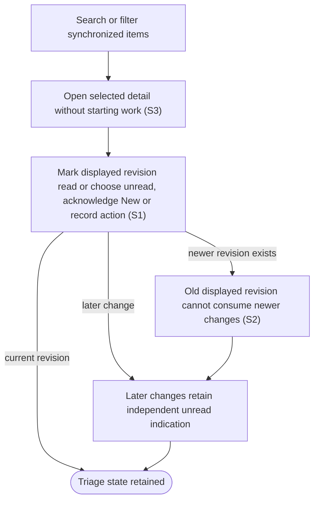

# Browse and triage the inbox

## Goal

The owner finds relevant items and tracks what is new, unread and already acted on independently.

## Preconditions

At least one repository has synchronized items.

## Main flow

1. Open the inbox and filter or search the synchronized items.
2. Open an item to inspect description, activity, checks and relationships.
3. Mark the displayed version read, mark it unread, acknowledge New, or record an action.
4. Continue receiving unread indications for later changes even after earlier actions.

## Alternatives and recovery

Listing items does not mark them read. A read action for an older displayed version does not consume newer changes. Opening an item never starts an agent. Reading on the provider website is not inferred. Successful item actions refresh visible detail/history while preserving independent drafts; a late response cannot replace a later selection.

## Scenarios

- **S1** Initial unread, New and action history remain independent.
- **S2** Marking an old displayed version read leaves a newer version unread.
- **S3** Opening detail, searching and filtering never start work.

<!-- flow-references -->
## Terminology and UI references

Glossary: [inbox](../glossary/README.md#inbox), [work-item](../glossary/README.md#work-item), [state-new](../glossary/README.md#state-new), [state-unread](../glossary/README.md#state-unread), [state-acted-on](../glossary/README.md#state-acted-on), [coverage-gap](../glossary/README.md#coverage-gap), [unverified-behavior](../glossary/README.md#unverified-behavior).
UI entities: [PAGE-INBOX](../ui/README.md#PAGE-INBOX), [P-INBOX-QUERY](../ui/README.md#P-INBOX-QUERY), [P-INBOX-LIST](../ui/README.md#P-INBOX-LIST), [P-ITEM-DETAIL](../ui/README.md#P-ITEM-DETAIL), [W-INBOX-QUERY](../ui/README.md#W-INBOX-QUERY), [W-SYNC-HEALTH](../ui/README.md#W-SYNC-HEALTH), [W-ITEM-ROW](../ui/README.md#W-ITEM-ROW), [W-INBOX-EMPTY](../ui/README.md#W-INBOX-EMPTY), [W-ITEM-OVERVIEW](../ui/README.md#W-ITEM-OVERVIEW), [W-ITEM-ACTIONS](../ui/README.md#W-ITEM-ACTIONS), [W-ITEM-HISTORY](../ui/README.md#W-ITEM-HISTORY), [C-FILTER](../ui/README.md#C-FILTER), [C-SELECT-ITEM](../ui/README.md#C-SELECT-ITEM), [C-EMPTY-SETUP](../ui/README.md#C-EMPTY-SETUP), [C-ITEM-STATE](../ui/README.md#C-ITEM-STATE).

## Flow diagram

## Implementation references

- [internal/app/app.go](../../internal/app/app.go) — Inbox sorting and independent user state (`func (a *App) UserAction(`)
- [web/src/main.tsx](../../web/src/main.tsx) — Inbox filters and revision-aware detail (`function ItemDetail(`)
- [internal/transport/mcp.go](../../internal/transport/mcp.go) — Separate listing, detail and state-changing operations
- [internal/domain/types.go](../../internal/domain/types.go) — Shared domain, persistence, transport or dependency contract
- [internal/store/store.go](../../internal/store/store.go) — Shared domain, persistence, transport or dependency contract
- [go.mod](../../go.mod) — Shared domain, persistence, transport or dependency contract
- [go.sum](../../go.sum) — Shared domain, persistence, transport or dependency contract
- [web/src/types.ts](../../web/src/types.ts) — Embedded UI build and host-fixture configuration
- [web/src/style.css](../../web/src/style.css) — Embedded UI build and host-fixture configuration
- [web/src/bridge.ts](../../web/src/bridge.ts) — Embedded UI build and host-fixture configuration
- [web/package.json](../../web/package.json) — Embedded UI build and host-fixture configuration
- [web/package-lock.json](../../web/package-lock.json) — Embedded UI build and host-fixture configuration
- [web/tsconfig.json](../../web/tsconfig.json) — Embedded UI build and host-fixture configuration
- [web/vite.config.ts](../../web/vite.config.ts) — Embedded UI build and host-fixture configuration
- [web/index.html](../../web/index.html) — Embedded UI build and host-fixture configuration
- [web/playwright.config.ts](../../web/playwright.config.ts) — Embedded UI build and host-fixture configuration
- [internal/testhost/main.go](../../internal/testhost/main.go) — Embedded UI build and host-fixture configuration
- [internal/testutil/fakecodex/main.go](../../internal/testutil/fakecodex/main.go) — Embedded UI build and host-fixture configuration
- [internal/testutil/testutil.go](../../internal/testutil/testutil.go) — Embedded UI build and host-fixture configuration
- [internal/web/embed.go](../../internal/web/embed.go) — Embedded UI build and host-fixture configuration

## Test references

- [internal/app/app_test.go](../../internal/app/app_test.go) — `func TestInboxRevisionStatesPriorityAndLinks(`; S1, S2. Baseline, later revisions and independent action history.
- [web/tests/factory.spec.ts](../../web/tests/factory.spec.ts) — `test("triage does not launch, launch edits and attention answer survive reopening"`; S3. Opening detail does not call prepare/start.
- [internal/transport/mcp_test.go](../../internal/transport/mcp_test.go) — `func TestAuthenticatedMCPDiscoveryToolsAndUI(`; S3. Read tools and app-only visibility are exercised.
- [web/tests/factory.spec.ts](../../web/tests/factory.spec.ts) — `test("item actions refresh visible history while unread, New and drafts remain independent"`; S1, S3. Action history refreshes immediately; Mark unread and acknowledge New remain independent, drafts survive and refresh sends no extra read or launch.
- [web/tests/factory.spec.ts](../../web/tests/factory.spec.ts) — `test("a delayed relationship refresh cannot replace a later selection or its drafts"`; S3. A held earlier relationship detail response cannot replace a later selected item or its independent drafts.

## Verification and gaps

Local suites: `go`, `browser`.
Fixture success does not establish real-host acceptance.
- **S1** — `gap-flow-triage-inbox-s1-01` · Unverified behavior · P2 · owner: user-flow-maintainer. Acknowledge/read/New/action-history independence now has a local browser fixture. Each filter combination and the complete installed-host matrix remain unverified. Next verification: Assert each filter combination and record the current installed-host New/unread/action matrix.

<!-- /flow-references -->
