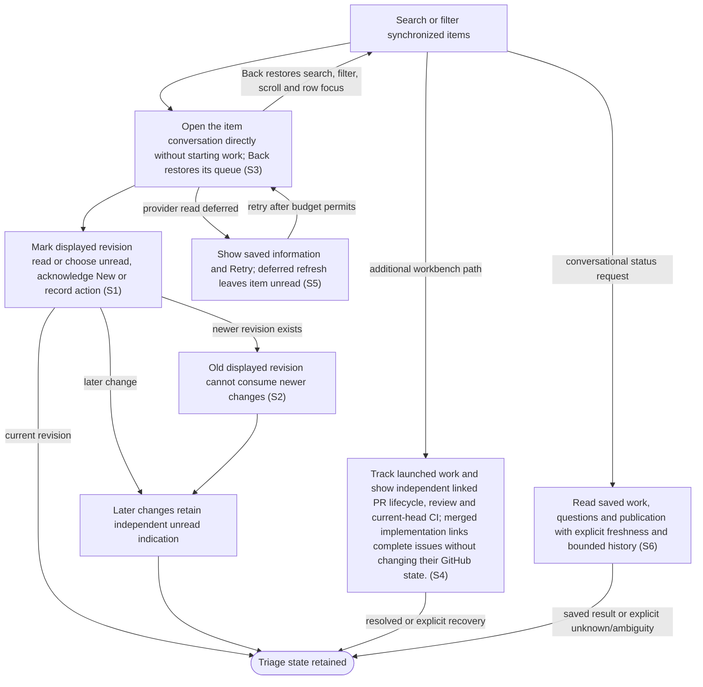

# Browse and triage the inbox

## Goal

The owner finds relevant items and tracks what is new, unread and already acted on independently.

## Preconditions

At least one repository has synchronized items.

## Main flow

1. Open Issues, defaulting to open issues including those with linked pull requests, sorted by priority with unknown priorities last. My PRs shows open pull requests authored by the authenticated account; Review PRs shows open requests to that account or its teams. Each tab retains its own search, filters and current page. Back restores row focus on that page when the row remains available. Search and filters cover the complete saved dataset before pagination; pages default to 50 rows, previous/next keeps every matching item reachable, and a changed query starts at its first page. No matches offers Clear filters. Repository/number links open the original source independently.
2. Select an item to open its conversation immediately with item information and a source-description summary drawn from its first substantive paragraph, skipping Markdown-only headings while retaining the original full description. Continue the newest retained run or see a prefilled editable first message; the list is replaced. Full description, activity, priority, checks and relationships are in Item details below chat. Published saved-state updates carry summaries; full activity and raw checks are fetched only for the selected item.
3. Mark the displayed version read, or use Actions to mark unread, acknowledge New or record an action.
4. Continue receiving unread indications for later changes even after earlier actions.

## Alternatives and recovery

Listing items and opening their external GitHub links do not mark them read. A failed or denied external link leaves the list active with visible feedback. A read action for an older displayed version does not consume newer changes. Opening an item never prepares or starts an agent. Transient detail reads retry and only a successfully displayed revision is marked read. Tool/business errors remain local and require explicit retry; stale read responses cannot replace a later selection. Existing retained work opens directly. New run remains available under Item details for a separate customized proposal. Reading on the provider website is not inferred. Successful item actions acknowledge acceptance separately from later completion, and committed updates refresh visible detail/history while preserving independent drafts; a late response cannot replace a later selection. Relationship drafts stay with their item across item and tab switches; the priority picker reflects the saved override. Routine sync times are omitted, nonempty history and less frequent controls are disclosed, and failures remain visible. Back restores the inbox list’s search/filter, scroll position and row focus when that row still exists. Each work-tab navigation opens its list; no empty detail pane remains. Identity and team-membership failures remain visible rather than guessing ownership.

## Scenarios

- **S1** Initial unread, New and action history remain independent.
- **S2** Marking an old displayed version read leaves a newer version unread.
- **S3** Focused queues apply pending/author/reviewer membership and priority order. Selecting an item opens its conversation with context; Back restores that queue. Listing, source links and selection never start work.

- **S4** Track launched work and show independent linked PR lifecycle, review and current-head CI; merged implementation links complete issues without changing their GitHub state.

- **S5** When a provider refresh is deferred, saved item details remain visible with an explicit Retry action. The item is not marked read until a successful refresh can present its displayed version; retrying never launches work.

- **S6** Find synchronized work conversationally by run ID, canonical item ID, GitHub URL or repository shorthand, or triage a filtered result page without opening the dashboard. Ambiguous identifiers return candidates without selecting or starting. Saved state returns immediately while stale or missing external observations refresh in the background under existing monitoring policy; observation time, refresh state, last error and retry time remain explicit. Queue/history pages are bounded and continue with the same filters.

<!-- flow-references -->
## Terminology and UI references

Glossary: [inbox](../glossary/README.md#inbox), [work-item](../glossary/README.md#work-item), [state-new](../glossary/README.md#state-new), [state-unread](../glossary/README.md#state-unread), [state-acted-on](../glossary/README.md#state-acted-on), [coverage-gap](../glossary/README.md#coverage-gap), [unverified-behavior](../glossary/README.md#unverified-behavior), [working-queue](../glossary/README.md#working-queue), [implementation-relationship](../glossary/README.md#implementation-relationship), [direct-launch](../glossary/README.md#direct-launch), [ui-projection](../glossary/README.md#ui-projection), [ui-change-cursor](../glossary/README.md#ui-change-cursor).
UI entities: [PAGE-INBOX](../ui/README.md#PAGE-INBOX), [P-INBOX-QUERY](../ui/README.md#P-INBOX-QUERY), [P-INBOX-LIST](../ui/README.md#P-INBOX-LIST), [P-ITEM-DETAIL](../ui/README.md#P-ITEM-DETAIL), [W-INBOX-QUERY](../ui/README.md#W-INBOX-QUERY), [W-SYNC-HEALTH](../ui/README.md#W-SYNC-HEALTH), [W-ITEM-ROW](../ui/README.md#W-ITEM-ROW), [W-INBOX-EMPTY](../ui/README.md#W-INBOX-EMPTY), [W-ITEM-OVERVIEW](../ui/README.md#W-ITEM-OVERVIEW), [W-ITEM-ACTIONS](../ui/README.md#W-ITEM-ACTIONS), [W-ITEM-HISTORY](../ui/README.md#W-ITEM-HISTORY), [C-FILTER](../ui/README.md#C-FILTER), [C-SELECT-ITEM](../ui/README.md#C-SELECT-ITEM), [C-ITEM-STATE](../ui/README.md#C-ITEM-STATE), [PAGE-AGENT](../ui/README.md#PAGE-AGENT), [C-BACK](../ui/README.md#C-BACK), [C-ITEM-SOURCE](../ui/README.md#C-ITEM-SOURCE), [PAGE-MY-PRS](../ui/README.md#PAGE-MY-PRS), [PAGE-REVIEW-PRS](../ui/README.md#PAGE-REVIEW-PRS), [W-NEW-CHAT](../ui/README.md#W-NEW-CHAT), [C-START-CHAT](../ui/README.md#C-START-CHAT), [PAGE-WORKING](../ui/README.md#PAGE-WORKING), [W-PR-EVIDENCE](../ui/README.md#W-PR-EVIDENCE).

## Flow diagram

## Implementation references

- [internal/app/app.go](../../internal/app/app.go) — Inbox sorting and independent user state (`func (a *App) UserAction(`)
- [web/src/main.tsx](../../web/src/main.tsx) — Inbox filters and revision-aware detail (`function ItemDetail(`)
- [internal/transport/mcp.go](../../internal/transport/mcp.go) — Separate listing, detail and state-changing operations
- [internal/domain/types.go](../../internal/domain/types.go) — Shared domain, persistence, transport or dependency contract
- [internal/store/store.go](../../internal/store/store.go) — Shared domain, persistence, transport or dependency contract
- [go.mod](../../go.mod) — Shared domain, persistence, transport or dependency contract
- [go.sum](../../go.sum) — Shared domain, persistence, transport or dependency contract
- [web/src/types.ts](../../web/src/types.ts) — Embedded UI build and host-fixture configuration
- [web/src/style.css](../../web/src/style.css) — Embedded UI build and host-fixture configuration
- [web/src/bridge.ts](../../web/src/bridge.ts) — Embedded UI build and host-fixture configuration
- [web/package.json](../../web/package.json) — Embedded UI build and host-fixture configuration
- [web/package-lock.json](../../web/package-lock.json) — Embedded UI build and host-fixture configuration
- [web/tsconfig.json](../../web/tsconfig.json) — Embedded UI build and host-fixture configuration
- [web/vite.config.ts](../../web/vite.config.ts) — Embedded UI build and host-fixture configuration
- [web/index.html](../../web/index.html) — Embedded UI build and host-fixture configuration
- [web/playwright.config.ts](../../web/playwright.config.ts) — Embedded UI build and host-fixture configuration
- [web/fixture-ports.ts](../../web/fixture-ports.ts) — Shared validated loopback fixture origins preserve default ports and allow isolated browser verification alongside another checkout. (`export const fixtureUIOrigin =`)
- [internal/testhost/main.go](../../internal/testhost/main.go) — Embedded UI build and host-fixture configuration
- [internal/testutil/fakecodex/main.go](../../internal/testutil/fakecodex/main.go) — Embedded UI build and host-fixture configuration
- [internal/testutil/testutil.go](../../internal/testutil/testutil.go) — Embedded UI build and host-fixture configuration
- [internal/web/embed.go](../../internal/web/embed.go) — Embedded UI build and host-fixture configuration
- [internal/app/work.go](../../internal/app/work.go) — Server queue membership and linked PR/work projections. (`func (a *App) projectWork(`)
- [internal/app/app.go](../../internal/app/app.go) — Bulk-load keyed user/assessment/ticket state and project list history fields before Go decoding; retain canonical linked-context hashing and full source/detail records. (`func (a *App) InboxSummaries(`)
- [internal/app/detail.go](../../internal/app/detail.go) — Targeted saved-state reads, compact tracking, durable progress or asynchronous observation without delaying status. (`func (a *App) ItemDetail(`)
- [internal/app/observations.go](../../internal/app/observations.go) — Targeted saved-state reads, compact tracking, durable progress or asynchronous observation without delaying status. (`func (a *App) observation(`)
- [internal/app/tracking.go](../../internal/app/tracking.go) — Saved bounded tracking returns only active running/waiting concurrency tokens for follow-up; inactive retained turns remain historical identity in currentRun, with no remote read required. (`func (a *App) TrackWork(`)
- [internal/store/reads.go](../../internal/store/reads.go) — Targeted saved-state reads, compact tracking, durable progress or asynchronous observation without delaying status. (`func Select[T any](`)
- [internal/transport/tracking.go](../../internal/transport/tracking.go) — Targeted saved-state reads, compact tracking, durable progress or asynchronous observation without delaying status. (`func (s *Server) dashboard(`)
- [internal/transport/ui_state.go](../../internal/transport/ui_state.go) — Asynchronous coherent publication, metadata-only watches and independent process reconciliation. (`func (s *Server) startUIState()`)
- [internal/transport/ui_state.go](../../internal/transport/ui_state.go) — Requested saved views, complete-dataset filters and 50-row default pagination. (`func (s *Server) readUIState(`)
- [internal/store/snapshot.go](../../internal/store/snapshot.go) — Atomic saved state/cursor WAL snapshot and durable metadata-only journal. (`func (s *Store) ReadView(`)
- [web/src/ui-changes.ts](../../web/src/ui-changes.ts) — One subscription dispatches affected domain/ID versions and defers hidden panel reads. (`export function publishUIChange(`)
- [web/defer-ui.mjs](../../web/defer-ui.mjs) — Production resource postpones bundled runtime parsing until after actionable shell paint. (`const scripts =`)
- [web/index.html](../../web/index.html) — Actionable navigation and query controls precede runtime/SDK initialization. (`id="boot-nav"`)
- [internal/store/store.go](../../internal/store/store.go) — Post-commit durable invalidations preserve legacy event contracts. (`func (s *Store) Write(`)
- [internal/testhost/performance.go](../../internal/testhost/performance.go) — Production embedded resource with retained-state, provider-latency and cold-server fixtures. (`func servePerformance(`)
- [web/playwright.performance.config.ts](../../web/playwright.performance.config.ts) — Isolated one-worker, zero-retry production performance verification. (`workers: 1`)

## Test references

- [internal/app/app_test.go](../../internal/app/app_test.go) — `func TestInboxRevisionStatesPriorityAndLinks(`; S1, S2. Baseline, later revisions and independent action history.
- [web/tests/launch.spec.ts](../../web/tests/launch.spec.ts) — `test("triage does not launch, launch edits and attention answer survive reopening"`; S3. Opening detail does not call prepare/start.
- [internal/transport/mcp_test.go](../../internal/transport/mcp_test.go) — `func TestAuthenticatedMCPDiscoveryToolsAndUI(`; S3. Read tools and app-only visibility are exercised.
- [web/tests/inbox.spec.ts](../../web/tests/inbox.spec.ts) — `test("item actions refresh visible history while unread, New and drafts remain independent"`; S1, S3. Action history refreshes immediately; Mark unread and acknowledge New remain independent, drafts survive and refresh sends no extra read or launch.
- [web/tests/inbox.spec.ts](../../web/tests/inbox.spec.ts) — `test("a delayed relationship refresh cannot replace a later selection or its drafts"`; S3. A held earlier relationship detail response cannot replace a later selected item or its independent drafts.
- [web/tests/attention.spec.ts](../../web/tests/attention.spec.ts) — `test("empty filtered inbox offers Clear filters and hides zero attention"`; S3. No matching items and Clear filters recover the visible list without launching.
- [web/tests/inbox.spec.ts](../../web/tests/inbox.spec.ts) — `test("item switching restores saved priorities and keeps relationship drafts by item"`; S1, S3. Saved priorities and per-item link drafts survive selection/tab changes without state leakage.
- [web/tests/inbox.spec.ts](../../web/tests/inbox.spec.ts) — `single-page navigation preserves list context and drafts at`; S1. Both themes and 1280px/390px widths assert exclusive list/item/agent pages, Back focus/scroll/query restoration and per-record draft preservation.
- [web/tests/accessibility.spec.ts](../../web/tests/accessibility.spec.ts) — `page changes keep keyboard focus usable when an unread row leaves the list`; S1, S3. A read item disappears from the unread list; Back and Clear filters recover without an empty detail panel.
- [web/tests/inbox.spec.ts](../../web/tests/inbox.spec.ts) — `small inbox GitHub links open the original issue and PR without selecting either`; S3. Original issue and pull request links use the host browser, preserve unread/New and keep the list active; row selection stays independent.
- [web/tests/inbox.spec.ts](../../web/tests/inbox.spec.ts) — `inbox GitHub link ${failure} failure stays in the list with visible feedback`; S3. Host rejection/failure is visible without marking an item read.
- [web/tests/accessibility.spec.ts](../../web/tests/accessibility.spec.ts) — `focused work queues use GitHub ownership review requests and pending priority`; S3. Both themes at 390px assert default open unlinked issue membership, P0-first/unknown-last ordering, author and individual/team review membership, independent filters/search, no launch/read on listing, no overflow and scoped Axe.
- [web/tests/launch.spec.ts](../../web/tests/launch.spec.ts) — `item opens a prefilled conversation and first-message Start stays explicit`; S3. Item opens Agent with summary, prefilled prompt and closed details; no intermediate item-only page or Open agent control, no work before Start, retained item draft, exact prepare/start payload and conversation afterward.
- [internal/app/work_queues_test.go](../../internal/app/work_queues_test.go) — `func TestInboxDetectsPullRequestsInBothDirectionsAndExternalEvidence(`; S3. Known forward/reverse PR links and explicit external PR evidence mark issue membership; removal clears it.
- [web/tests/inbox.spec.ts](../../web/tests/inbox.spec.ts) — `transient item read failure retries and marks only the successfully displayed revision read`; S3. Three failed item requests retry locally; only the recovered displayed revision is marked read, once.
- [web/tests/connection.spec.ts](../../web/tests/connection.spec.ts) — `read tool errors are not mistaken for retryable transport errors`; S3. Tool-result errors containing Connection failed are not transport failures: item read is attempted once and explicit Retry remains.
- [internal/app/work_tracking_test.go](../../internal/app/work_tracking_test.go) — `func TestWorkingTracksSessionsUntilGitHubCompletion(`; S4. Working completion follows explicit implementation links; references do not complete an issue.
- [web/tests/inbox.spec.ts](../../web/tests/inbox.spec.ts) — `Working and linked PR monitoring follow server projections`; S4. Both narrow themes consume server membership and linked summaries, preserve source links and remove merged work without launch.
- [internal/transport/mcp_test.go](../../internal/transport/mcp_test.go) — `func TestDashboardSummariesOmitHistoryAndKeepFullItemDetail(`; S3. Megabyte item history and own/linked check lists are absent from the shared snapshot; reviewer membership, body, head and revision remain, and selected-item reads retain exact full content.
- [web/tests/inbox.spec.ts](../../web/tests/inbox.spec.ts) — `review queues from multiple repositories load full details from compact snapshots`; S3. Both narrow themes display requested PRs from two repositories using compact summaries and fetch full activity/checks only after selection without preparing or starting work.
- [web/tests/inbox.spec.ts](../../web/tests/inbox.spec.ts) — `a deferred detail refresh retains saved information and unread state until a successful retry`; S2, S5. Cached information remains available; deferred refresh does not mark read before explicit successful retry.
- [internal/app/github_usage_test.go](../../internal/app/github_usage_test.go) — `func TestIndexPreservesHistoryInvalidatesChangedHeadAndBudgetEditsKeepAssessmentPolicy(`; S3, S5. Cheap index preserves full history and cannot reuse current-head status for a changed PR head.
- [web/tests/launch.spec.ts](../../web/tests/launch.spec.ts) — `linked PR changes refresh full selected details without consuming another read or launch`; S3, S4. Latest linked PR metadata refreshes selected full detail without replaying read or launch actions.
- [web/tests/sessions.spec.ts](../../web/tests/sessions.spec.ts) — `Markdown issue headings do not replace the useful conversation summary`; S3. Skip Markdown-only headings in the compact source summary, retain full body and assert that reading never prepares/starts work.
- [internal/app/inbox_reads_test.go](../../internal/app/inbox_reads_test.go) — `func TestInboxBulkReadsPreserveContextKeysAndCurrentRevisions(`; S1, S2, S3. Full/compact reads agree outside omitted history; legacy embedded IDs do not override storage keys, source history remains intact and linked item/ticket changes invalidate inference immediately.
- [internal/store/store_test.go](../../internal/store/store_test.go) — `func TestRecordsKeepStorageKeysAndProjectionPreservesSource(`; S1, S2. Bulk reads retain database keys; bound JSON projections omit only requested large fields, scope to requested bucket and do not modify stored records.
- [internal/app/inbox_bench_test.go](../../internal/app/inbox_bench_test.go) — `func BenchmarkInboxRetainedHistory(`; S3. Synthetic retained-history fixture at452items/1372links/265externalPRs/27large skill snapshots measures full/compact reads plus dashboard attention lookup latency and allocations. No user data, provider calls or timing pass threshold.
- [internal/app/tracking_test.go](../../internal/app/tracking_test.go) — `func TestTrackingResolvesTargetsPaginatesHistoryAndSeparatesReceiptHeads(`; S6. Asserts saved-state target resolution, exact question/receipt pagination, bounded projection or daily one/two-call delivery behavior.
- [internal/app/tracking_test.go](../../internal/app/tracking_test.go) — `func TestSavedReadsDoNotWaitForSynchronizationOrBlockedGitHubAndDeduplicate(`; S6. Provider/sync locks and blocked HTTP cannot delay saved reads; repeat freshness reads deduplicate the observation worker.
- [internal/app/tracking_test.go](../../internal/app/tracking_test.go) — `func TestObservationPauseCooldownAndFailureRetainSavedState(`; S6. Failed receipts retain successful data and timestamp; pause and repository retry suppress new requests.
- [internal/transport/reads_bench_test.go](../../internal/transport/reads_bench_test.go) — `func TestReadPerformancePilotFixture(`; S6. Opt-in loopback latency and size assertions, measured separately; ordinary Go verification skips this benchmark.
- [internal/app/tracking_test.go](../../internal/app/tracking_test.go) — `func TestFreshDetailKeepsMonitoringFocusWithoutProviderRefresh(`; S6. A fresh local detail read retains the original selected-item monitoring focus without scheduling provider work.
- [internal/app/tracking_test.go](../../internal/app/tracking_test.go) — `func TestSavedTrackingReadsDuringUncommittedSynchronizationWrite(`; S6. Hold an actual uncommitted write transaction while tracking returns committed saved item/review state without waiting for its writer or the queued local focus hint.
- [web/tests/inbox.spec.ts](../../web/tests/inbox.spec.ts) — `saved unread details remain unread when refresh is`; S5, S6. Paused/cooldown/unavailable observations with no error retain visible saved details and unread state; draft editing does not mark read or launch.
- [internal/app/tracking_test.go](../../internal/app/tracking_test.go) — `func TestTrackingContinuationUsesOnlyActiveTurnTokens(`; S6. Idle/interrupted/failed continuations return empty expectedTurn while preserving historical turnId; running/waiting retain the real token and reject stale active submissions.
- [web/tests/inbox.spec.ts](../../web/tests/inbox.spec.ts) — `cooldown without an error keeps a retry action and saved details unread until fresh`; S5, S6. Error-free cooldown displays saved detail, retry time and explicit Retry; retry while still deferred preserves unread and draft with zero read markers, then a permitted fresh response marks exactly once and preserves draft without launching work.
- [web/performance/tests/launch.spec.ts](../../web/performance/tests/launch.spec.ts) — `production embedded direct launch: every fresh and warm sample is at most 100 ms`; S3. Every one of 20 fresh and 10 warm built-resource direct launches has actionable painted navigation within 100 ms; empty/cold/retained states use delayed provider fixtures and retain timing evidence.
- [internal/transport/ui_state_test.go](../../internal/transport/ui_state_test.go) — `TestUIProjectionPaginatesAndSearchesCompleteRetainedStateWithoutProviders`; S3. All 1,000 saved items are reachable through 50-row pages; body search finds a later item, selection remains reachable and no provider endpoint is called.
- [internal/transport/ui_state_test.go](../../internal/transport/ui_state_test.go) — `TestUIWatchPublishesCommittedStateAndReconcilesOtherConnections`; S3. Rollback produces no invalidation; an independent connection commit wakes the watch only after matching saved state and its cursor are published.
- [internal/transport/ui_state_test.go](../../internal/transport/ui_state_test.go) — `TestUIWatchCoalescesBurstsConcurrentWritersReconnectAndResync`; S3. Two writers retain all affected IDs through a reconnect; invalidations contain metadata only and unavailable/future cursors require resync.
- [internal/store/ui_journal_test.go](../../internal/store/ui_journal_test.go) — `TestUIJournalCommitsRollbackCASAndLegacyCursor`; S3. Rollbacks and failed CAS produce no UI journal entry; successful CAS does, private buckets are excluded and legacy event cursors remain unchanged.
- [internal/store/ui_journal_test.go](../../internal/store/ui_journal_test.go) — `TestReadViewPinsDataAndCursorAcrossConcurrentConnection`; S3. A concurrent connection commit cannot mix a newer entity with an older cursor inside a WAL read view.
- [web/tests/inbox.spec.ts](../../web/tests/inbox.spec.ts) — `published inbox responses preserve the newer query when older reads finish later`; S3. A delayed earlier query cannot replace a later selection/result, and legacy broad-read polling is absent.
- [web/tests/inbox.spec.ts](../../web/tests/inbox.spec.ts) — `hidden views catch up through the shared subscription without rereading panels while hidden`; S3. A durable update is observed by the single watch while a hidden view performs no panel reads; visibility restores the latest saved item.
- [web/tests/inbox.spec.ts](../../web/tests/inbox.spec.ts) — `inbox pagination and complete-dataset search keep later saved items reachable`; S3. Three pages expose all 125 fixture items; searching on the last page resets pagination and opens item 125.
- [web/tests/reports.spec.ts](../../web/tests/reports.spec.ts) — `the shared subscription updates Messages while Reported issues is open`; S3. A run/attention-only publication updates the Messages badge while Reports remains selected, without rereading the report list.
- [web/tests/inbox.spec.ts](../../web/tests/inbox.spec.ts) — `a selected item outside the current page never renders an earlier selected entry`; S3. A delayed selected-entry read for a question outside the current page never renders an earlier item, then shows the correct retained item.
- [web/tests/inbox.spec.ts](../../web/tests/inbox.spec.ts) — `queue navigation cannot activate rows belonging to the previous query`; S3. Previous-query rows cannot be activated under a newly selected queue while its saved read is pending.
- [web/tests/fixtures.ts](../../web/tests/fixtures.ts) — `export async function host(`; S1, S2, S3, S4, S5, S6. Shared per-test mocked host and serial assembled-daemon helpers; scenario assertions remain mapped to their feature spec files.

## Verification and gaps

Local suites: `go`, `browser`, `inbox-performance`, `ui-performance`.
Fixture success does not establish real-host acceptance.
- **S1** — `gap-flow-triage-inbox-s1-01` · Unverified behavior · P2 · owner: user-flow-maintainer. Acknowledge/read/New/action-history independence now has a local browser fixture. Each filter combination and the complete installed-host matrix remain unverified. Next verification: Assert each filter combination and record the current installed-host New/unread/action matrix.

<!-- /flow-references -->
