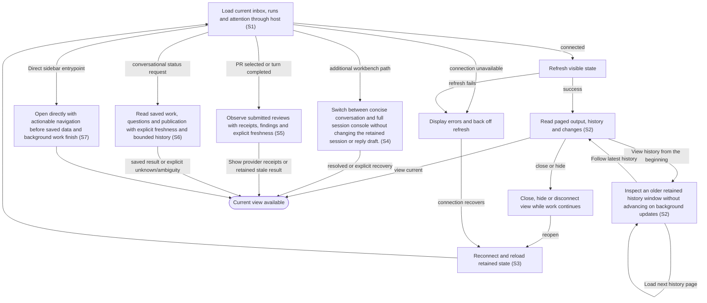

# View live status, transcript and changes across reconnects

## Goal

The owner follows work from the embedded application and can return to it without losing progress.

## Preconditions

A supported host has opened the connected application. Updated embedded application content is advertised with a new identity so the host can distinguish it from an older cached view.

## Main flow

1. Open directly from the host sidebar, bypassing a conversational model turn. Navigation and loading controls become usable before saved data or background work finishes. The controlled fixture launch boundary is 100 ms for every fresh launch and warm reopening; actual host latency is recorded separately. Load the inbox as a full-width list beneath compact navigation. Opening an item or agent replaces the list with one focused page; owned surfaces preserve the active host theme even when the surrounding document is transparent.
2. Populate the requested view from saved state, then receive shared change notifications after committed background results are published. Refresh affected views, preserving drafts, focus and selection. Reads do not request external refreshes. Display connection errors when saved-state delivery fails.
3. Read output and file changes incrementally, with progress/status messages, final replies, user messages and readable errors visible; plans, diffs, command output and internal summaries remain under collapsed Details or the optional same-session console; load older history on request. An older history window remains inspectable across background updates; advance its pages explicitly or choose to follow the latest output again.
4. Close or reconnect the view and reload retained state.
5. For a pull request, read posted reviews above the conversation: open the GitHub receipt, inspect the author, verdict, reviewed commit, body and inline findings, and distinguish current-head from earlier-head reviews. Review observations include all authors and do not imply that a particular run published them.

## Alternatives and recovery

Source-terminated sessions display Stopped with their reason and retained history. They cannot accept follow-up or resume; cleanup remains available without discarding modified files.

Continuing output remains visible even when updates arrive faster than saved reads complete. Hidden views defer new panel/history reads and catch up when visible, including when no further work change occurs. Disconnected views resume from their last change cursor; a missing cursor requires a full saved-state resync. A restored database may have an earlier cursor: every affected view still reloads, incremental history restarts from its beginning and local reply/evidence drafts remain intact. Rolled-back changes notify no view. Concurrent writers and bursts retain all affected identifiers. Failed initialization does not poison the open view: later attempts use a fresh connection. Only known reads retry bounded transient transport failures; business/tool errors remain distinct. Recovered subscriptions clear their own connection feedback, while transcript reads clear only their local read failures. Existing output and drafts remain visible. A healthy background read never dismisses an uncertain action response, and Start, Send, answers and saves are not automatically replayed. The view uses the host connection and receives no local credentials. Closing the view leaves agents running. Transcript output and diffs are paged rather than loaded without bounds. Ordinary relationship and message drafts survive tab/record changes within the open app; closing/reloading ends that draft lifetime. Branding, permanent footer and successful sync timestamps are omitted. Connected status is available to assistive technology; connecting/disconnected feedback and failures remain visible. Back restores list context and nonempty history remains disclosed. Settings opens in an independent view using the same authenticated connection; saving configuration leaves an already-open task view and its drafts intact.

## Scenarios

- **S1** Embedded view communicates through the host connection without direct local-service requests.
- **S2** Incremental state and paged transcript preserve older history without losing concurrent changes. Saved prepared proposals from another connected view appear without manually reloading or starting work. A previous empty refresh result cannot freeze later updates; retained status reflects completed actions even when the host reuses identical read responses.
- **S3** Reopening a view retains pending attention and live work; hidden/disconnected refreshes back off.

Conversation rendering keeps human-facing agent messages, your replies and saved-message delivery status visible. Queue acceptance precedes agent delivery, and uncertainty remains visible without automatic replay. Technical activity remains under Details, with structured error data there and the readable error message visible. Streaming updates preserve that distinction; a technical-only active stream shows a concise waiting status. Pending questions and approvals remain actionable outside Details.

- **S4** Switch between concise conversation and full session console without changing the retained session or reply draft.

Automatic recovery exchanges appear as technical activity under Details or in the session console. Your responses keep their ordinary conversation role.

An execution diagnostic received after completion preserves the completed turn
and does not repeat its work or change a later follow-up.

- **S5** Submitted reviews refresh after a PR turn and remain available to plugin skills with provider receipt URLs and explicit freshness. A failed refresh retains saved reviews and the last successful observation; an unverified result is not an empty or successful publication result. Reading, refreshing and opening review links never starts work or repeats publication. Saved details and receipts render while a background refresh is pending; errors retain the previous successful observation. Fresh host reads do not force provider requests or bypass pause, budgets and cooldowns.

- **S6** A conversational status read includes the selected item and current/retained run summaries, exact pending questions, a bounded agent progress or final-response excerpt with its timestamp and continuation reference, and saved current-head versus earlier-head publication receipts. The current run uses the same retained-session preference as the embedded view; a run identifier selects that exact run. Missing progress projections and missing external observations remain explicitly unavailable. Longer history, questions and receipts use independent pagination. Dashboard opening is explicit and returns a compact overview; the embedded app obtains its own state through the host connection.

- **S7** Direct launch paints actionable navigation within 100 ms in every controlled fresh/warm fixture sample, while delayed providers remain pending. Saved-state counts, filters and pages load independently; actual ChatGPT and typed-chat latency require separate evidence.

<!-- flow-references -->
## Terminology and UI references

Glossary: [host](../glossary/README.md#host), [inbox](../glossary/README.md#inbox), [agent-run](../glossary/README.md#agent-run), [transcript](../glossary/README.md#transcript), [coverage-gap](../glossary/README.md#coverage-gap), [unverified-behavior](../glossary/README.md#unverified-behavior), [session-console](../glossary/README.md#session-console), [published-review](../glossary/README.md#published-review), [direct-launch](../glossary/README.md#direct-launch), [ui-projection](../glossary/README.md#ui-projection), [ui-change-cursor](../glossary/README.md#ui-change-cursor).
UI entities: [S-FACTORY](../ui/README.md#S-FACTORY), [PAGE-INBOX](../ui/README.md#PAGE-INBOX), [PAGE-AGENTS](../ui/README.md#PAGE-AGENTS), [PAGE-SETTINGS](../ui/README.md#PAGE-SETTINGS), [P-IDENTITY](../ui/README.md#P-IDENTITY), [P-NAVIGATION](../ui/README.md#P-NAVIGATION), [P-FEEDBACK](../ui/README.md#P-FEEDBACK), [W-IDENTITY](../ui/README.md#W-IDENTITY), [W-NAVIGATION](../ui/README.md#W-NAVIGATION), [W-GLOBAL-ERROR](../ui/README.md#W-GLOBAL-ERROR), [W-CONNECTION-BLOCKER](../ui/README.md#W-CONNECTION-BLOCKER), [C-NAVIGATE](../ui/README.md#C-NAVIGATE), [C-STATE-REFRESH](../ui/README.md#C-STATE-REFRESH), [C-GLOBAL-ATTENTION](../ui/README.md#C-GLOBAL-ATTENTION), [W-TRANSCRIPT](../ui/README.md#W-TRANSCRIPT), [W-MESSAGE](../ui/README.md#W-MESSAGE), [C-TRANSCRIPT](../ui/README.md#C-TRANSCRIPT), [C-FOLLOW-UP](../ui/README.md#C-FOLLOW-UP), [PAGE-AGENT](../ui/README.md#PAGE-AGENT), [C-BACK](../ui/README.md#C-BACK), [S-SETTINGS](../ui/README.md#S-SETTINGS), [C-OPEN-SETTINGS](../ui/README.md#C-OPEN-SETTINGS), [W-SESSION-CONSOLE](../ui/README.md#W-SESSION-CONSOLE), [C-SESSION-CONSOLE](../ui/README.md#C-SESSION-CONSOLE), [W-PR-EVIDENCE](../ui/README.md#W-PR-EVIDENCE).

## Flow diagram

## Implementation references

- [web/src/main.tsx](../../web/src/main.tsx) — Visible polling, transcript rendering and retained selections (`function Factory(`)
- [web/src/bridge.ts](../../web/src/bridge.ts) — Host-only app bridge
- [internal/transport/mcp.go](../../internal/transport/mcp.go) — Snapshots, incremental changes and transcript tools (`func (s *Server) snapshot(`)
- [internal/store/store.go](../../internal/store/store.go) — Bounded event and transcript pagination
- [internal/domain/types.go](../../internal/domain/types.go) — Shared domain, persistence, transport or dependency contract
- [go.mod](../../go.mod) — Shared domain, persistence, transport or dependency contract
- [go.sum](../../go.sum) — Shared domain, persistence, transport or dependency contract
- [web/src/types.ts](../../web/src/types.ts) — Embedded UI build and host-fixture configuration
- [web/src/style.css](../../web/src/style.css) — Owned themed body/root/main backgrounds preserve the embedded surface when host styling makes html transparent.
- [web/package.json](../../web/package.json) — Embedded UI build and host-fixture configuration
- [web/package-lock.json](../../web/package-lock.json) — Embedded UI build and host-fixture configuration
- [web/tsconfig.json](../../web/tsconfig.json) — Embedded UI build and host-fixture configuration
- [web/vite.config.ts](../../web/vite.config.ts) — Embedded UI build and host-fixture configuration
- [web/index.html](../../web/index.html) — Embedded UI build and host-fixture configuration
- [web/playwright.config.ts](../../web/playwright.config.ts) — Embedded UI build and host-fixture configuration
- [web/fixture-ports.ts](../../web/fixture-ports.ts) — Shared validated loopback fixture origins preserve default ports and allow isolated browser verification alongside another checkout. (`export const fixtureUIOrigin =`)
- [internal/testhost/main.go](../../internal/testhost/main.go) — Embedded UI build and host-fixture configuration
- [internal/testutil/fakecodex/main.go](../../internal/testutil/fakecodex/main.go) — Embedded UI build and host-fixture configuration
- [internal/testutil/testutil.go](../../internal/testutil/testutil.go) — Embedded UI build and host-fixture configuration
- [internal/web/embed.go](../../internal/web/embed.go) — Embedded UI build and host-fixture configuration
- [internal/transport/mcp.go](../../internal/transport/mcp.go) — Advertises the embedded UI under a full-content SHA256 URI and binds all tool/output-template references to it, retaining only an unadvertised exact legacy-read alias. (`func registerUIResource(`)
- [internal/web/embed.go](../../internal/web/embed.go) — Configuration opens through its own bridged document entry. (`func SettingsHTML(`)
- [web/src/reviews.tsx](../../web/src/reviews.tsx) — Visible submitted review receipts, verdict/head, inline findings, cached freshness and host links. (`export function PostedReviews(`)
- [internal/app/review_publication.go](../../internal/app/review_publication.go) — Durable budgeted review observations, failure retention and post-turn refresh. (`func (a *App) ReadPRReviews(`)
- [internal/providers/github_reviews.go](../../internal/providers/github_reviews.go) — Read submitted review and inline-comment pages; omit pending drafts. (`func (g *GitHub) PublishedReviews(`)
- [internal/app/tracking.go](../../internal/app/tracking.go) — Saved bounded tracking returns only active running/waiting concurrency tokens for follow-up; inactive retained turns remain historical identity in currentRun, with no remote read required. (`func (a *App) TrackWork(`)
- [internal/app/observations.go](../../internal/app/observations.go) — Targeted saved-state reads, compact tracking, durable progress or asynchronous observation without delaying status. (`func (a *App) observation(`)
- [internal/store/reads.go](../../internal/store/reads.go) — Targeted saved-state reads, compact tracking, durable progress or asynchronous observation without delaying status. (`func Select[T any](`)
- [internal/store/progress.go](../../internal/store/progress.go) — Targeted saved-state reads, compact tracking, durable progress or asynchronous observation without delaying status. (`func (t *Tx) ProjectProgress(`)
- [internal/transport/tracking.go](../../internal/transport/tracking.go) — Targeted saved-state reads, compact tracking, durable progress or asynchronous observation without delaying status. (`func (s *Server) dashboard(`)
- [internal/aiworkflows/client.go](../../internal/aiworkflows/client.go) — YAML workflow execution retains native session policy, questions, interrupts and application-owned recovery. (`func (c *Client) CallWorkflow(`)
- [internal/aiworkflows/workflows/review.yml](../../internal/aiworkflows/workflows/review.yml) — Embedded model-turn workflow definition and native structured-output contract where applicable. (`name:`)
- [internal/aiworkflows/workflows/task.yml](../../internal/aiworkflows/workflows/task.yml) — Embedded model-turn workflow definition and native structured-output contract where applicable. (`name:`)
- [internal/transport/ui_state.go](../../internal/transport/ui_state.go) — Asynchronous coherent publication, metadata-only watches and independent process reconciliation. (`func (s *Server) startUIState()`)
- [internal/transport/ui_state.go](../../internal/transport/ui_state.go) — Requested saved views, complete-dataset filters and 50-row default pagination. (`func (s *Server) readUIState(`)
- [internal/store/snapshot.go](../../internal/store/snapshot.go) — Atomic saved state/cursor WAL snapshot and durable metadata-only journal. (`func (s *Store) ReadView(`)
- [web/src/ui-changes.ts](../../web/src/ui-changes.ts) — One subscription dispatches affected domain/ID versions and defers hidden panel reads. (`export function publishUIChange(`)
- [web/defer-ui.mjs](../../web/defer-ui.mjs) — Production resource postpones bundled runtime parsing until after actionable shell paint. (`const scripts =`)
- [web/index.html](../../web/index.html) — Actionable navigation and query controls precede runtime/SDK initialization. (`id="boot-nav"`)
- [internal/store/store.go](../../internal/store/store.go) — Post-commit durable invalidations preserve legacy event contracts. (`func (s *Store) Write(`)
- [internal/testhost/performance.go](../../internal/testhost/performance.go) — Production embedded resource with retained-state, provider-latency and cold-server fixtures. (`func servePerformance(`)
- [web/playwright.performance.config.ts](../../web/playwright.performance.config.ts) — Isolated one-worker, zero-retry production performance verification. (`workers: 1`)

## Test references

- [web/tests/factory.spec.ts](../../web/tests/factory.spec.ts) — `test("MCP bridge drives the assembled daemon through launch, question, answer and follow-up"`; S1. Assembled app rejects direct iframe daemon requests.
- [internal/app/app_test.go](../../internal/app/app_test.go) — `func TestAgentQuestionExactlyOnceAndRecovery(`; S2. Transcript pagination exposes more history.
- [web/tests/factory.spec.ts](../../web/tests/factory.spec.ts) — `test("triage does not launch, launch edits and attention answer survive reopening"`; S3. Controlled-host fixture reloads host and iframe with a question pending, reopens the original waiting run and choices, answers the original request once and follows up without another launch.
- [internal/transport/mcp_test.go](../../internal/transport/mcp_test.go) — `func TestAuthenticatedMCPDiscoveryToolsAndUI(`; S1, S2. Authenticated tools/resources and discovery fixture.
- [web/tests/factory.spec.ts](../../web/tests/factory.spec.ts) — `test(`Axe WCAG A/AA scans the owned app iframe across core states in ${theme} theme``; S1. Late host-transparent html is reproduced in both themes; computed body/root/main backgrounds stay theme-owned and fourteen scoped Axe scans require zero automated violations. Does not establish full/manual/installed-host accessibility.
- [internal/transport/ui_resource_test.go](../../internal/transport/ui_resource_test.go) — `func TestUIResourceContentIdentityAndCompatibility(`; S1. Actual SDK fixture asserts stable same-content and changed-content UI identity, matching current tool/resource metadata and exact HTML; only the original exact URI reads current content unadvertised, while unknown/previous hashes and query variants reject. CSP domains stay empty. This does not prove host refresh or installed UI acceptance.
- [web/tests/factory.spec.ts](../../web/tests/factory.spec.ts) — `test("Open agent targets the newest retained run and keeps message drafts across tabs and runs"`; S3. Open-app per-run message drafts survive run/tab changes, distinct from reload persistence.
- [web/tests/factory.spec.ts](../../web/tests/factory.spec.ts) — `agent conversation shows human messages and keeps technical activity under Details`; S2. Human progress/final/user/error messages stay visible; technical activity is one secondary disclosure, live updates preserve the distinction and questions remain actionable.
- [web/tests/factory.spec.ts](../../web/tests/factory.spec.ts) — `single-page navigation preserves list context and drafts at`; S3. Both themes and 1280px/390px widths assert exclusive list/item/agent pages, Back focus/scroll/query restoration and per-record draft preservation.
- [web/tests/factory.spec.ts](../../web/tests/factory.spec.ts) — `separate settings can save while the inbox view retains its item and agent drafts`; S3. Both surfaces remain open independently while shared data refreshes.
- [web/tests/factory.spec.ts](../../web/tests/factory.spec.ts) — `initial bridge failures retry a fresh handshake without reloading or losing state`; S1, S3. Three failed SDK initializations recover through four fresh handshakes with one successful initial snapshot and no stale banner.
- [web/tests/factory.spec.ts](../../web/tests/factory.spec.ts) — `transient polling outage recovers without a stale error banner or lost first message`; S1, S3. A real SDK JSON-RPC connection fault drives reconnect feedback; healthy reads clear it and preserve the first-message draft with no mutation.
- [web/tests/factory.spec.ts](../../web/tests/factory.spec.ts) — `transcript recovery keeps output and draft while removing only its own read error`; S1, S3. After transcript transport failures, previous output and follow-up draft remain and only the local read error disappears on recovery.
- [web/tests/factory.spec.ts](../../web/tests/factory.spec.ts) — `exact host-wrapped MCP connection error retries a read without exposing its framework text`; S1. Known host-wrapped transport failures recover on reads without framework banners, and mutations remain one attempt.
- [web/tests/factory.spec.ts](../../web/tests/factory.spec.ts) — `exact host-wrapped connection failure never replays a mutation`; S1. Known host-wrapped transport failures recover on reads without framework banners, and mutations remain one attempt.
- [web/tests/factory.spec.ts](../../web/tests/factory.spec.ts) — `technical-only activity leaves a concise waiting state in the conversation`; S1. Technical-only work does not flood the normal conversation; status and pending attention remain available.
- [web/tests/factory.spec.ts](../../web/tests/factory.spec.ts) — `text fallback opens the same session console`; S4. Presentation switch reveals technical output and preserves the same draft and session.
- [internal/app/review_requests_test.go](../../internal/app/review_requests_test.go) — `func TestPreparePRReviewResolvesDefaultsAndStartsOnlyExplicitly(`; S2. Each preparation advances the incremental event cursor with its own prepared run, while retaining no workspace/thread before explicit Start.
- [web/tests/factory.spec.ts](../../web/tests/factory.spec.ts) — `test("fresh read markers observe external changes after a host memoizes an empty journal page"`; S2, S3. Host memoizes identical reads after empty journal response; two external changes still appear without reload, launch or message, using distinct read markers.
- [internal/app/review_publication_test.go](../../internal/app/review_publication_test.go) — `func TestPostedReviewsRefreshAfterTurnAndRetainReceiptsOnFailure(`; S5. Completed PR turns refresh actual GitHub receipts; repeated reads respect cadence; failure and pause retain successful receipts and freshness; issues reject.
- [internal/providers/github_reviews_test.go](../../internal/providers/github_reviews_test.go) — `func TestPublishedReviewsKeepVerdictCommitAndPaginatedInlineEvidence(`; S5. Read-only authenticated pagination preserves verdict, author, commit, body and correctly grouped inline comments; pending drafts are excluded.
- [web/tests/factory.spec.ts](../../web/tests/factory.spec.ts) — `posted reviews show verified verdicts findings and refresh after completion`; S5. Both narrow themes expose receipts/verdicts/current or earlier commits/body/inline comments, unverified and stale states; snapshot version refresh, host links and manual refresh launch no work; scoped Axe passes.
- [internal/transport/mcp_test.go](../../internal/transport/mcp_test.go) — `func TestAuthenticatedMCPDiscoveryToolsAndUI(`; S5. Model/app discovery exposes read_pr_reviews; authenticated read_pr_reviews/read_run preserve receipt URL, reviewed head and inline findings.
- [internal/app/tracking_test.go](../../internal/app/tracking_test.go) — `func TestTrackingResolvesTargetsPaginatesHistoryAndSeparatesReceiptHeads(`; S6. Asserts saved-state target resolution, exact question/receipt pagination, bounded projection or daily one/two-call delivery behavior.
- [internal/store/progress_test.go](../../internal/store/progress_test.go) — `func TestProgressProjectionBackfillAndPrivateRunProjection(`; S6. Asserts saved-state target resolution, exact question/receipt pagination, bounded projection or daily one/two-call delivery behavior.
- [internal/transport/tracking_test.go](../../internal/transport/tracking_test.go) — `func TestMCPDailyWorkflowsUseOneOrTwoCallsAndReturnDeliveryState(`; S6. Asserts saved-state target resolution, exact question/receipt pagination, bounded projection or daily one/two-call delivery behavior.
- [internal/app/tracking_test.go](../../internal/app/tracking_test.go) — `func TestSavedReadsDoNotWaitForSynchronizationOrBlockedGitHubAndDeduplicate(`; S6. Provider/sync locks and blocked HTTP cannot delay saved reads; repeat freshness reads deduplicate the observation worker.
- [internal/app/tracking_test.go](../../internal/app/tracking_test.go) — `func TestObservationPauseCooldownAndFailureRetainSavedState(`; S6. Failed receipts retain successful data and timestamp; pause and repository retry suppress new requests.
- [internal/transport/reads_bench_test.go](../../internal/transport/reads_bench_test.go) — `func TestReadPerformancePilotFixture(`; S6. Opt-in loopback latency and size assertions, measured separately; ordinary Go verification skips this benchmark.
- [internal/app/review_publication_test.go](../../internal/app/review_publication_test.go) — `func TestPostedReviewRefreshCoalescesPostTurnHintsDuringPendingRead(`; S5. Repeated turn-completion hints coalesce into one post-read pass; a receipt posted during an older read is neither lost nor fetched by concurrent workers.
- [internal/store/progress_test.go](../../internal/store/progress_test.go) — `func TestProgressBackfillReassemblesChunkedFinalWithoutRequestHistoryScan(`; S6. Startup backfill reconstructs a roughly7MiB escaped/Unicode completion across more than200 chunks before projection; bounded excerpt and final-chunk cursor/time persist, partial chunks never become output.
- [internal/app/tracking_test.go](../../internal/app/tracking_test.go) — `func TestSavedTrackingReadsDuringUncommittedSynchronizationWrite(`; S6. Hold an actual uncommitted write transaction while tracking returns committed saved item/review state without waiting for its writer or the queued local focus hint.
- [internal/store/progress_test.go](../../internal/store/progress_test.go) — `func TestCompletionChunksPreserveEscapesAndWaitForValidWholeObjects(`; S6. Legacy completion framing preserves escaped quotes/braces/backslashes and Unicode at valid split positions, waits for valid whole objects and isolates adjacent objects without repeated prefix validation.
- [internal/store/progress_test.go](../../internal/store/progress_test.go) — `func TestProgressBackfillDiscardsPartialAndMalformedChunksAtMethodBoundary(`; S6. Partial/malformed completion history stays unavailable until method reset; newer actual journal projection wins against stale reconstructed progress through its cursor guard.
- [web/tests/factory.spec.ts](../../web/tests/factory.spec.ts) — `chunked owner and agent completions remain normal conversation across journal pages`; S2. Long owner/unstreamed agent Unicode and escaped completions across a journal page retain You/Agent roles and ID coalescing in the normal conversation; raw partial/malformed and command output stay under initially collapsed Details.
- [internal/app/tracking_test.go](../../internal/app/tracking_test.go) — `func TestTrackingContinuationUsesOnlyActiveTurnTokens(`; S6. Idle/interrupted/failed continuations return empty expectedTurn while preserving historical turnId; running/waiting retain the real token and reject stale active submissions.
- [internal/aiworkflows/client_test.go](../../internal/aiworkflows/client_test.go) — `func TestEveryAIWorkflowUsesYAMLAndWaitsForProviderCompletion(`; S1. YAML execution regression; assertions preserve provider completion, admission, authority or private checkpoint boundaries.
- [internal/aiworkflows/client_test.go](../../internal/aiworkflows/client_test.go) — `func TestInteractiveCompletionDoesNotWaitForCheckpointFlush(`; S1. Blocked workflow checkpoint cannot delay native completion/answer routing; closing drains the successful checkpoint.
- [internal/aiworkflows/client_test.go](../../internal/aiworkflows/client_test.go) — `func TestInteractiveCheckpointFailureReportsDiagnosticWithoutChangingCompletion(`; S2. Failed terminal persistence emits one sanitized originating-turn diagnostic after immediate native completion; an active follow-up is preserved and native work is not replayed.
- [web/performance/tests/launch.spec.ts](../../web/performance/tests/launch.spec.ts) — `production embedded direct launch: every fresh and warm sample is at most 100 ms`; S1, S3. Every one of 20 fresh and 10 warm built-resource direct launches has actionable painted navigation within 100 ms; empty/cold/retained states use delayed provider fixtures and retain timing evidence.
- [internal/transport/ui_state_test.go](../../internal/transport/ui_state_test.go) — `TestUIProjectionPaginatesAndSearchesCompleteRetainedStateWithoutProviders`; S1, S3. All 1,000 saved items are reachable through 50-row pages; body search finds a later item, selection remains reachable and no provider endpoint is called.
- [internal/transport/ui_state_test.go](../../internal/transport/ui_state_test.go) — `TestUIWatchPublishesCommittedStateAndReconcilesOtherConnections`; S1, S3. Rollback produces no invalidation; an independent connection commit wakes the watch only after matching saved state and its cursor are published.
- [internal/transport/ui_state_test.go](../../internal/transport/ui_state_test.go) — `TestUIWatchCoalescesBurstsConcurrentWritersReconnectAndResync`; S1, S3. Two writers retain all affected IDs through a reconnect; invalidations contain metadata only and unavailable/future cursors require resync.
- [internal/store/ui_journal_test.go](../../internal/store/ui_journal_test.go) — `TestUIJournalCommitsRollbackCASAndLegacyCursor`; S1, S3. Rollbacks and failed CAS produce no UI journal entry; successful CAS does, private buckets are excluded and legacy event cursors remain unchanged.
- [internal/store/ui_journal_test.go](../../internal/store/ui_journal_test.go) — `TestReadViewPinsDataAndCursorAcrossConcurrentConnection`; S1, S3. A concurrent connection commit cannot mix a newer entity with an older cursor inside a WAL read view.
- [web/tests/factory.spec.ts](../../web/tests/factory.spec.ts) — `published inbox responses preserve the newer query when older reads finish later`; S1, S3. A delayed earlier query cannot replace a later selection/result, and legacy broad-read polling is absent.
- [web/tests/factory.spec.ts](../../web/tests/factory.spec.ts) — `hidden views catch up through the shared subscription without rereading panels while hidden`; S1, S3. A durable update is observed by the single watch while a hidden view performs no panel reads; visibility restores the latest saved item.
- [web/tests/factory.spec.ts](../../web/tests/factory.spec.ts) — `inbox pagination and complete-dataset search keep later saved items reachable`; S1, S3. Three pages expose all 125 fixture items; searching on the last page resets pagination and opens item 125.
- [web/performance/tests/launch.spec.ts](../../web/performance/tests/launch.spec.ts) — `production embedded direct launch: every fresh and warm sample is at most 100 ms`; S7. All fresh and warm samples meet the 100 ms controlled fixture launch boundary; actual host latency remains unverified.
- [internal/app/tracking_test.go](../../internal/app/tracking_test.go) — `TestBackgroundObservationsAdvanceWithoutOpeningAView`; S1. Saved reads trigger no provider work; independent background monitoring starts without a view and persists failed observations while retaining saved item detail.
- [web/tests/factory.spec.ts](../../web/tests/factory.spec.ts) — `the shared subscription updates Messages while Reported issues is open`; S1. A run/attention-only publication updates the Messages badge while Reports remains selected, without rereading the report list.
- [web/tests/factory.spec.ts](../../web/tests/factory.spec.ts) — `a selected item outside the current page never renders an earlier selected entry`; S1. A delayed selected-entry read for a question outside the current page never renders an earlier item, then shows the correct retained item.
- [web/tests/factory.spec.ts](../../web/tests/factory.spec.ts) — `observation-only publications refresh the selected saved error without a broad read`; S1, S3. Saved provider errors refresh the selected item on an owner-ID invalidation, without loading broad shared state.
- [internal/web/embed_test.go](../../internal/web/embed_test.go) — `TestProductionShellPrecedesDeferredRuntime`; S7. Critical shell HTML and working event handlers appear before the inert runtime text; executable runtime parsing remains deferred past shell paint.
- [web/tests/factory.spec.ts](../../web/tests/factory.spec.ts) — `full resync to an earlier cursor reloads Reports and preserves its evidence draft`; S3. Restoring an earlier database cursor reloads the selected report after a previous higher publication without clearing its evidence draft.
- [web/tests/factory.spec.ts](../../web/tests/factory.spec.ts) — `full resync reloads plugin administration at an earlier cursor without clearing its draft`; S3. Plugin administration rereads saved inventory after a lower-cursor full resync while preserving the selector draft and performing no management mutation.
- [web/tests/factory.spec.ts](../../web/tests/factory.spec.ts) — `full resync resets a retained transcript cursor and reloads saved detail while keeping its message draft`; S3. Full resync for the same run ID restarts incremental history from zero, removes invalid old output, reloads selected saved observation and keeps the message draft.
- [web/tests/factory.spec.ts](../../web/tests/factory.spec.ts) — `older retained history stays inspectable across updates and advances only on request`; S2. A 1,300-event run exposes its beginning in an inspectable bounded window; background updates do not move that window, explicit next advances it and follow latest resumes updates without clearing the draft.
- [internal/transport/ui_state_test.go](../../internal/transport/ui_state_test.go) — `TestUIInitialPublicationNeedsNoLifetimeInvalidationHistory`; S1, S3. A full current-state publication succeeds without decoding retired lifetime invalidations, and an older cursor requires full resync.
- [internal/transport/ui_state_test.go](../../internal/transport/ui_state_test.go) — `TestUITranscriptPublicationLeavesSummariesCurrentAndNotifiesOnlyHistory`; S1, S3. Output-only commits publish a transcript-domain invalidation with unchanged summaries, while a real run-state commit still updates visible work state.
- [web/tests/factory.spec.ts](../../web/tests/factory.spec.ts) — `transcript-only publications update output without broad state reads`; S1, S3. A transcript-only publication updates the open conversation without a broad saved-state read.
- [web/tests/factory.spec.ts](../../web/tests/factory.spec.ts) — `repository-only resume refreshes selected detail and posted-review freshness`; S1, S3. Repository-only resume updates posted-review monitoring status and reloads selected saved detail while preserving its draft and making no sync/start call.
- [internal/transport/ui_state_test.go](../../internal/transport/ui_state_test.go) — `BenchmarkUIOutputPublication`; S1. Record allocation and duration evidence for output publication on 1,000 items, 3,000 relationships and 100 runs; this profile alone makes no latency-gate coverage claim.
- [web/tests/factory.spec.ts](../../web/tests/factory.spec.ts) — `full resync clears a local Start acceptance overlay without replaying the launch`; S3. A restored authoritative prepared state clears the local accepted-run overlay without replaying Start.
- [web/tests/factory.spec.ts](../../web/tests/factory.spec.ts) — `continuing transcript publications coalesce while delayed reads still render valid prefixes`; S2, S3. Continuous slow saved reads render valid prefixes with one request in flight instead of starving on repeated publication.
- [web/tests/factory.spec.ts](../../web/tests/factory.spec.ts) — `hidden retained history pauses pagination and resumes on visibility without a new publication`; S2, S3. An in-flight prefix may complete after hide; continuation pauses until visibility resumes, even without new events.
- [web/tests/factory.spec.ts](../../web/tests/factory.spec.ts) — `a hidden full resync rejects a delayed reply from the previous state epoch`; S3. A delayed pre-resync snapshot cannot become current while the widget is hidden or block restored state on show.
- [web/tests/factory.spec.ts](../../web/tests/factory.spec.ts) — `a hidden older read cannot consume newer run and attention invalidations`; S3. A delayed older response while hidden cannot clear later run/attention work; show refreshes both current items and Messages.
- [web/tests/factory.spec.ts](../../web/tests/factory.spec.ts) — `failed requested view reads recover without a new journal publication`; S3. Exhausted transport retries for a requested view retain local error feedback despite healthy idle watches, then recover automatically without a new commit.
- [web/tests/factory.spec.ts](../../web/tests/factory.spec.ts) — `observation-only completion refreshes posted review monitoring state`; S3. A saved review observation completion clears pending status on observation-only invalidation even when the review record version is unchanged.

## Verification and gaps

Local suites: `go`, `browser`, `ui-performance`, `inbox-performance`.
Fixture success does not establish real-host acceptance.
- **S2** — `gap-flow-view-live-work-s2-01` · Unverified behavior · P2 · owner: user-flow-maintainer. Concurrent snapshot/cursor ordering and large diff pagination need focused tests. Next verification: Add concurrent snapshot/cursor ordering and multi-page large-diff fixture cases that assert no missed, repeated or reordered retained events.
- **S3** — `gap-flow-view-live-work-s3-01` · Unverified behavior · P1 · owner: specification-coordinator. No installed-host connected one-hour soak is established by this development port. Hidden/disconnected visibility timing and backoff transitions also lack focused assertions; reconnect/iframe fixtures do not prove those variants. Next verification: Exercise hidden/disconnected visibility and retry-backoff transitions with focused fixture assertions, then record a connected one-hour soak for the actual installed port version as bounded dated evidence.
- **S6** — `gap-flow-view-live-work-s6-01` · Unverified behavior · P2 · owner: user-flow-maintainer. Synthetic fixture measurements cover saved lookup/publication, queue pages, configured launch, nonsecret answer/local delivery, retained-thread follow-up and explicit dashboard paths. No installed-version or real Work acceptance is established by this development port. Actual-host normal, ambiguous-target, retained-history/large-page, changed-head receipt, cooldown/error and uncertain-delivery variants remain unverified. Next verification: Observe normal conversational paths and the ambiguity, history/large-page, changed-head, cooldown/error and uncertain-delivery variants through an explicitly scoped private-pilot campaign for the installed port version; keep fixture and host evidence separate.
- **S7** — `gap-flow-direct-launch-host` · Unverified behavior · P2 · owner: user-flow-maintainer. The 100 ms bound covers the production embedded UI in a controlled fixture host. Actual ChatGPT sidebar latency and typed-chat model processing have not been measured on this build. Next verification: Measure actual direct sidebar launches in the approved host/session and record their latency separately; preserve the fixture boundary.

<!-- /flow-references -->
