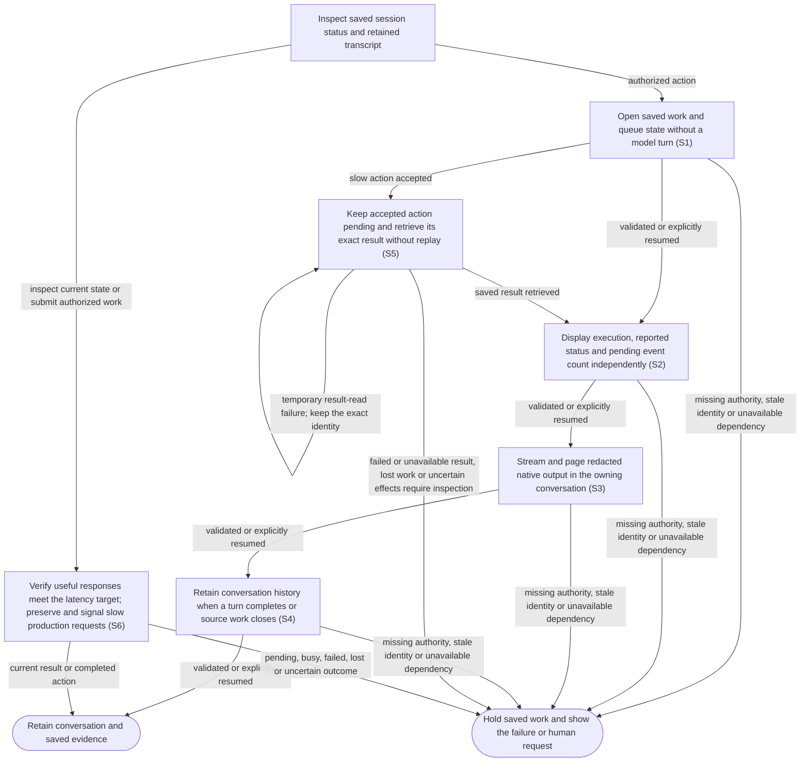

# Inspect saved session status and retained transcript

## Goal

Inspect saved session status and retained transcript.

## Preconditions

The private owner connection is established. Application data starts clean in the session-state database; native Codex authentication and configuration remain outside application state. GitHub source text is task data, not new authority.

## Main flow

1. Open saved work and queue state without a model turn.

2. Display execution, reported status and pending event count independently.

   Blocked and answered transitions notify the owning session subscription without
   including question or answer text. Answering one request keeps reported status
   blocked while another explicit status request remains; native blocking requests
   independently keep execution waiting.

3. Stream and page redacted native output in the owning conversation.

   In Configuration, show owner messages and intentional communication cards,
   questions and proposal controls. Keep ordinary native narration and internal
   status summaries in diagnostics rather than the visible conversation.

4. Retain conversation history when a turn completes or source work closes.

## Alternatives and recovery

Read-only inspection does not launch a model turn. Surface validation or provider errors and retain saved work. Human questions, explicit interruptions and uncertain deliveries hold automatic dispatch. Resume against current retained history; never replay an uncertain send or an answered RPC blindly. Explicit cleanup preserves dirty worktrees.

Saved content is current only after its required saved revisions are ready. While
the requested revision is preparing, show loading and disable actions needing that
content. Searches include saved source bodies. Large source, configuration and exact
question documents remain complete through versioned parts; never silently discard
functional text. A lost or abandoned detail view does not acknowledge a revision.

Show local submission feedback before waiting for the connection. Acceptance is
separate from delivery: keep queued and running work pending, and preserve the
owning conversation draft until delivery succeeds. Navigation and unrelated
conversations remain usable. Repeated request identities retrieve the original
work; connection recovery never submits the command again. After restart, effects
with retained intent are uncertain and memory-only work can be lost. Neither is
authority to replay a mutation or reuse an expired answer.

A slow response remains pending until completion or caller/service cancellation. Exceeding the latency target signals a diagnostic breach while preserving the original result and request identity; it does not fail the request. Verification fails when useful responses exceed the target.

Background operations have a separate five-minute execution deadline. An interrupted or timed-out effect remains uncertain and requires inspection; it never authorizes automatic replay.

After a service restart, the open view retires its old version and waits for
current saved content. Late prior-service responses cannot replace or acknowledge
content. Keep the selected conversation, navigation and unsent drafts.

## Scenarios

- **S1** — Open saved work and queue state without a model turn.
- **S2** — Display execution, reported status and pending event count independently.
- **S3** — Stream and page redacted native output in the owning conversation.
- **S4** — Retain conversation history when a turn completes or source work closes.
- **S5** — Keep an accepted slow action pending and retrieve its result without replay.

- **S6** — Verify useful plugin responses meet the latency target while slow production requests remain pending, signal their delay and complete without replay.

## Verification scope

The assertion references below establish their fixture scope. Native installed-host, real-provider and assistive-technology acceptance require separate dated observations. The retired pipeline editor, review artifacts, AI question repair and built-in issue-report ledger have no compatibility path.

<!-- flow-references -->
## Terminology and UI references

Glossary: [retained-session](../glossary/README.md#retained-session), [execution-state](../glossary/README.md#execution-state), [reported-work-status](../glossary/README.md#reported-work-status), [operation-receipt](../glossary/README.md#operation-receipt), [daemon-instance](../glossary/README.md#daemon-instance), [read-projection](../glossary/README.md#read-projection), [document-chunk](../glossary/README.md#document-chunk).
UI entities: [S-FACTORY](../ui/README.md#S-FACTORY), [W-TRANSCRIPT](../ui/README.md#W-TRANSCRIPT), [W-WORK-STATUS](../ui/README.md#W-WORK-STATUS), [W-EVENT-BATCHES](../ui/README.md#W-EVENT-BATCHES), [W-CONNECTION-BLOCKER](../ui/README.md#W-CONNECTION-BLOCKER).

## Flow diagram

## Implementation references

- [web/src/wrapper.tsx](../../web/src/wrapper.tsx) — Saved inbox, session conversation, human input and confirmed configuration. (`function Factory(`)
- [internal/transport/factory.go](../../internal/transport/factory.go) — Session, configuration, event and retained triage APIs. (`func NewFactory(`)
- [internal/factory/requests.go](../../internal/factory/requests.go) — Exact session-bound native requests and explicit status, without classifiers. (`func (s *Service) Answer(`)
- [internal/factory/service.go](../../internal/factory/service.go) — Durable canonical sessions, event queue, quiet clock and delivery claims. (`func (s *Service) Chat(`)
- [internal/testhost/main.go](../../internal/testhost/main.go) — Current view-live-work implementation or fixture/build dependency.
- [internal/testhost/performance.go](../../internal/testhost/performance.go) — Current view-live-work implementation or fixture/build dependency.
- [web/fixture-ports.ts](../../web/fixture-ports.ts) — Current view-live-work implementation or fixture/build dependency.
- [web/package-lock.json](../../web/package-lock.json) — Current view-live-work implementation or fixture/build dependency.
- [web/package.json](../../web/package.json) — Current view-live-work implementation or fixture/build dependency.
- [web/playwright.performance.config.ts](../../web/playwright.performance.config.ts) — Current view-live-work implementation or fixture/build dependency.
- [web/vite.config.ts](../../web/vite.config.ts) — Current view-live-work implementation or fixture/build dependency.
- [web/tsconfig.json](../../web/tsconfig.json) — Current view-live-work implementation or fixture/build dependency.
- [web/playwright.config.ts](../../web/playwright.config.ts) — Current view-live-work implementation or fixture/build dependency.
- [internal/transport/factory_projection.go](../../internal/transport/factory_projection.go) — Bounded view-specific bodyless inbox and compact session/question state; source detail and configuration are separate. (`func factoryState(`)
- [internal/transport/operations.go](../../internal/transport/operations.go) — Immediate memory admission with explicit operation state and original daemon/request identity; metadata durability precedes effects. (`func (q *operationQueue) submit(`)
- [web/src/bridge.ts](../../web/src/bridge.ts) — Retrieve the exact pending action result without replaying accepted work. (`export async function call<T>(`)
- [internal/codex/client.go](../../internal/codex/client.go) — Apply caller cancellation to native write admission and full stdin pipes; a partial write disconnects and reports uncertain delivery. (`func (c *Client) send(`)
- [internal/httpbudget/budget.go](../../internal/httpbudget/budget.go) — Observe slow finite responses without latency cancellation; bound admission/body buffers and preserve caller/service cancellation and acknowledged SSE lifetime. (`func Wrap(`)
- [internal/transport/projections.go](../../internal/transport/projections.go) — Background immutable snapshot preparation and revision matching; exact large-document chunks. (`func (c *projectionCache) read(`)
- [internal/store/revisions.go](../../internal/store/revisions.go) — Committed dependency revisions isolate unrelated transcript traffic and selected items. (`func (s *Store) Revision(`)
- [internal/httpbudget/budget.go](../../internal/httpbudget/budget.go) — Apply the 64 KiB bound to the complete parsed tool response, including SDK errors before tool middleware; keep large resources independent. (`func LimitResponse(`)
- [internal/transport/operations.go](../../internal/transport/operations.go) — Account every serialized terminal functional body independently of retained identity metadata. (`func operationPayloadBytes(`)
- [internal/transport/operations.go](../../internal/transport/operations.go) — Evict oldest terminal results/errors under the retained-body ceiling while preserving original state and explicit unavailable-detail markers. (`func (q *operationQueue) pruneResultsLocked(`)
- [web/src/bridge.ts](../../web/src/bridge.ts) — Retire obsolete instance-scoped read ownership without repeating accepted commands. (`export function onInstanceChange(`)
- [internal/httpbudget/latency.go](../../internal/httpbudget/latency.go) — Bounded asynchronous sanitized latency signals retain process-local request identity, actual status and exact slow/drop counters without canceling business work. (`func observeLatency(`)

## Test references

- [web/tests/wrapper.spec.ts](../../web/tests/wrapper.spec.ts) — `opening an issue or PR does not create or flush a session`; S1. Opening saved issue and PR detail sends no session mutation.
- [web/tests/wrapper.spec.ts](../../web/tests/wrapper.spec.ts) — `execution reported status and pending events stay separate`; S2. Execution idle, reported done and pending event count render independently.
- [web/tests/assembled.spec.ts](../../web/tests/assembled.spec.ts) — `assembled native session retains thread across question answer and follow-up`; S3. Real MCP daemon and fake native subprocess carry exact native answer and follow-up in retained conversation.
- [internal/factory/service_test.go](../../internal/factory/service_test.go) — `func TestSecretAnswerRedactsSplitStreamingAndRetainedOutput(`; S3. Secret answers redact split deltas, completed output and echoed native request options in persisted records; fresh-service retained-thread resume reloads vault redactions for new completed output.
- [internal/factory/service_test.go](../../internal/factory/service_test.go) — `func TestRepositoryQuietOverrideAndIdleWithoutStatus(`; S4. Repository quiet override, completion without report, and source closure retain history.
- [internal/transport/ui_resource_test.go](../../internal/transport/ui_resource_test.go) — `func TestUIResourceContentIdentityAndUnknownURI(`; S1. Current view-live-work fixture assertion TestUIResourceContentIdentityAndUnknownURI. Inspect its exact assertion scope.
- [internal/transport/ui_resource_test.go](../../internal/transport/ui_resource_test.go) — `func TestSettingsResourceIsIndependentFromInbox(`; S1. Current view-live-work fixture assertion TestSettingsResourceIsIndependentFromInbox. Inspect its exact assertion scope.
- [web/performance/tests/launch.spec.ts](../../web/performance/tests/launch.spec.ts) — `test("production embedded direct launch: every fresh and warm sample is at most 100 ms`; S1. Current view-live-work fixture assertion production embedded direct launch: every fresh and warm sample is at most 100 ms. Inspect its exact assertion scope.
- [internal/web/embed_test.go](../../internal/web/embed_test.go) — `func TestSettingsDocumentHasIndependentEntry(`; S1. Current view-live-work fixture assertion TestSettingsDocumentHasIndependentEntry. Inspect its exact assertion scope.
- [internal/web/embed_test.go](../../internal/web/embed_test.go) — `func TestProductionShellPrecedesDeferredRuntime(`; S1. Current view-live-work fixture assertion TestProductionShellPrecedesDeferredRuntime. Inspect its exact assertion scope.
- [web/tests/wrapper-fixtures.ts](../../web/tests/wrapper-fixtures.ts) — `export async function host(`; S1. Fixture MCP host dependency for the named browser assertions; helper presence alone claims no behavior coverage.
- [internal/transport/fixture_test.go](../../internal/transport/fixture_test.go) — `func newTrackingFixture(`; S1. Authenticated native-session MCP fixture for API logging assertions; not standalone scenario evidence.
- [web/tests/wrapper.spec.ts](../../web/tests/wrapper.spec.ts) — `streamed output and its completed message render once`; S3. Matching streamed and completed agent text appears once while distinct final messages remain visible.
- [web/tests/wrapper.spec.ts](../../web/tests/wrapper.spec.ts) — `failed second selection never pairs old context with new actions`; S1. Rejected detail B clears prior detail A; B title and disabled send prevent actions on mismatched saved context.
- [internal/transport/factory_test.go](../../internal/transport/factory_test.go) — `func TestFactoryStatePagesCompactDataAndExplicitDelivery(`; S1, S2. A thousand large saved sources yield bounded bodyless pages; body search/filter precede paging, queue state is explicit, historical questions/proposals are bounded, and full source requires detail read.
- [web/tests/wrapper.spec.ts](../../web/tests/wrapper.spec.ts) — `same-item source and relationship versions refresh and Back reopens saved detail`; S1. Saved source revision and relationship version changes reload the same selected detail; Back and reopening request fresh detail.
- [web/tests/wrapper.spec.ts](../../web/tests/wrapper.spec.ts) — `retained transcript drains available pages without polling delays`; S3. Twelve available history pages of 100 events reach the latest row within five seconds, retain at most 1,000 rows and request exact advancing cursors.
- [web/tests/wrapper.spec.ts](../../web/tests/wrapper.spec.ts) — `fragmented transcript waits for complete ordered sets across pages`; S3. A page-spanning fragmented completion reconstructs Unicode, quotes and controls exactly, preserves a distinct complete message, and never renders an incomplete tail.
- [internal/transport/factory_test.go](../../internal/transport/factory_test.go) — `func TestFactoryItemReadsRequireDisplayedRevisionAcknowledgmentAndVersions(`; S1. Detail fetch has no read mutation; source and relationship changes alter matching detail versions; stale acknowledgment leaves the current revision unread until its explicit exact acknowledgment.
- [internal/factory/regressions_test.go](../../internal/factory/regressions_test.go) — `func TestCompletedOutputKeepsAgentMessagesAndByteBounds(`; S3. Non-agent completions add no output journal rows; large agent completion rows stay byte-bounded and reassemble the exact message ID and text.
- [internal/store/factory_reads_test.go](../../internal/store/factory_reads_test.go) — `func TestSessionOutputFragmentsBoundRowsAndPreserveExactJSON(`; S3. Every fragment row is valid UTF8 and at most 32 KiB, paged output is bounded, and ordered fragments reconstruct the exact Unicode/control/quote JSON.
- [web/tests/wrapper.spec.ts](../../web/tests/wrapper.spec.ts) — `idle state polls use change versions and mutations refresh without losing the view`; S1, S2. Idle polls carry sinceVersion and preserve the accepted view through unchanged responses; saved mutations produce a new view and tab/search transitions omit the old cursor.
- [web/tests/wrapper.spec.ts](../../web/tests/wrapper.spec.ts) — `a delayed state version cannot replace a newer accepted refresh`; S1, S2. After a held older full response is consumed, its first successor poll retains the newer accepted version cursor; current rows remain visible and delayed stale rows stay absent.
- [internal/factory/regressions_test.go](../../internal/factory/regressions_test.go) — `func TestNativeStreamUsesCompactIdentityAndPreservesQueuedContexts(`; S3. Fifty deltas preserve 20 queued contexts of 100 KiB each; runtime rows stay within 512 bytes with pendingCount 20 and no pending payload, accept an opaque queue sentinel, leave the UI cursor unchanged and reject stale epochs.
- [internal/store/factory_reads_test.go](../../internal/store/factory_reads_test.go) — `func TestSessionRuntimeProjectionIsAtomicForPutCASDeleteAndRollback(`; S3. Compact runtime epoch/thread identity follows session Put/CAS/delete atomically; rollback and failed CAS preserve the prior identity.
- [internal/transport/factory_test.go](../../internal/transport/factory_test.go) — `func TestFactoryStateVersionSkipsIdleAndRejectsUnpreparedData(`; S1, S2. A same-instance unchanged cursor returns only version/unchanged; an unprepared invalid source fails, deleting that source refreshes the projection, and transcript output does not invalidate inbox state.
- [internal/factory/review6_test.go](../../internal/factory/review6_test.go) — `func TestRetainedRefreshCannotOverwriteConcurrentWebhook(`; S2. An in-flight retained PR refresh cannot replace a newer webhook row on either success or provider failure: current head/body/discussion/CI and automatic links remain, and actual batch/native input agrees.
- [internal/factory/review6_test.go](../../internal/factory/review6_test.go) — `func TestBlockedAndAnsweredTransitionsEmitSessionSubscription(`; S2. An exact session.changed webhook subscriber receives one blocked and one answered transition; notifications contain neither question nor answer text.
- [internal/factory/review6_test.go](../../internal/factory/review6_test.go) — `func TestAnswerPreservesOtherExplicitBlockedRequests(`; S2. For blocking and nonblocking native input, an invalid answer fails; valid native and first explicit-status answers retain blocked/waiting while a second explicit status question remains. Only the final answer yields working/running.
- [internal/transport/factory_test.go](../../internal/transport/factory_test.go) — `func TestFactoryStateReusesInboxAcrossQueriesAndRefreshesAfterMutation(`; S1. After warming the derived inbox, a raw SQL sentinel makes any repeated full decode fail. Changed filter/page/search/tab and conversation queries still succeed from the retained projection; an ordinary source mutation invalidates the cache and returns the updated title.
- [internal/transport/operations_test.go](../../internal/transport/operations_test.go) — `func TestOperationsDeduplicateBoundAdmissionAndReserveControl(`; S5. Duplicate IDs retain original identities; pending queue capacity is bounded and reserved control workers execute behind blocked ordinary workers.
- [internal/transport/operations_test.go](../../internal/transport/operations_test.go) — `func TestOperationRestartReportsUncertainAndLostWithoutReplay(`; S5. Unfinished retained intent recovers as uncertain and old-instance memory-only work is lost; neither identity can replay the original mutation.
- [internal/transport/api_performance_test.go](../../internal/transport/api_performance_test.go) — `func TestUserFacingAPILatency(`; S1, S5. Runtime registered SDK/custom receiving-method keys and the discovered tool catalog are completeness oracles. Every method, including notifications, has a timed meaningful success, accepted notification, exact rejection or real stream acknowledgement. Every exposed tool is timed through authenticated HTTP across empty/cold/1000-source retained state, blocked storage/logging, saturation, continuous writes and three-second provider/process delays; useful current reads and healthy operation completion are required. Every sample must stay within75ms; host/network transit and background completion are separate.
- [web/tests/wrapper.spec.ts](../../web/tests/wrapper.spec.ts) — `accepted slow mutation polls one identity and recovers a lost polling response`; S5. Five consecutive failed result reads exceed the ordinary retry budget while Send and the draft remain pending; explicit completion gate proves exact-identity recovery and one created session.
- [web/tests/wrapper.spec.ts](../../web/tests/wrapper.spec.ts) — `delayed operation error preserves the draft without repeating the action`; S5. Delayed failure displays the error and preserves the draft without replaying the action.
- [internal/codex/client_write_test.go](../../internal/codex/client_write_test.go) — `func TestBlockedNativeWriteHonorsDeadlineAndPreservesUncertainDelivery(`; S5. A real full stdin pipe stops on the call deadline, reports uncertain delivery, disconnects its partial stream and removes the pending response.
- [internal/codex/client_write_test.go](../../internal/codex/client_write_test.go) — `func TestQueuedNativeWriterCancelsWithoutWritingOrDisconnectingActiveWriter(`; S5. Cancelling a queued writer does not disconnect the active write or emit queued mutation bytes; later active cancellation closes the partial stream.
- [internal/transport/response_budget_test.go](../../internal/transport/response_budget_test.go) — `func TestMCPActualSubscriptionListenHandshakeAndCancellation(`; S3. Real SDK subscription listen emits an actual acknowledged data event within100ms, survives125ms and exits on request cancellation.
- [internal/httpbudget/budget_test.go](../../internal/httpbudget/budget_test.go) — `func TestSlowResponseRetainsAdmissionAndReturnsSuccess(`; S1, S5. A request held beyond 125 ms keeps its uncanceled context and worker slot; saturated admission starts no second action, and release returns the original successful response.
- [internal/httpbudget/budget_test.go](../../internal/httpbudget/budget_test.go) — `func TestResponseBufferLimitAndCancellation(`; S1, S5. Response limit is a terminal rejection and request/service cancellation suppresses late output.
- [internal/httpbudget/budget_test.go](../../internal/httpbudget/budget_test.go) — `func TestCompletedResponseKeepsWorkerThroughAuditAndReportsWireOutcome(`; S1. Completed202 identity remains available while audit is delayed and consumes admitted capacity through actual audit exit.
- [internal/httpbudget/budget_test.go](../../internal/httpbudget/budget_test.go) — `func TestEmptyOrPrimingSSEFlushPreservesDelayedStream(`; S3. Empty or priming-comment flushes wait for real data; an acknowledgement delayed beyond 125 ms still reaches the caller.
- [internal/httpbudget/budget_test.go](../../internal/httpbudget/budget_test.go) — `func TestSSEHandshakeRetainsStreamAndCancelsOnDisconnect(`; S3. Real acknowledged stream remains open beyond125ms, keeps admission and ends on disconnect.
- [internal/httpbudget/api_performance_test.go](../../internal/httpbudget/api_performance_test.go) — `func TestHTTPBoundaryAPILatency(`; S1, S5. Isolated 75 ms per-sample verification covers successful finite results, accepted work, capacity rejection and response-size limits without imposing a production latency cutoff.
- [web/tests/wrapper.spec.ts](../../web/tests/wrapper.spec.ts) — `accepted mutation retains its identity through HTTP503 poll outages`; S5. Exact accepted identity and one original mutation survive five503 poll failures until explicit completion.
- [web/tests/wrapper.spec.ts](../../web/tests/wrapper.spec.ts) — `HTTP503 after mutation delivery preserves the draft without replay`; S5. Original mutation503 preserves draft and prompts state inspection without replay.
- [web/tests/wrapper.spec.ts](../../web/tests/wrapper.spec.ts) — `oversized accepted result ends polling with draft retained and no replay`; S5. Oversized final result is terminal; polling ends and draft remains with one mutation.
- [web/tests/wrapper.spec.ts](../../web/tests/wrapper.spec.ts) — `accepted operation reports terminal provider HTTP503 without polling again`; S5. Terminal structured provider HTTP503 is reported once rather than mistaken for transient transport503; exact-ID polling ends, Send becomes enabled, draft survives and one original mutation exists.
- [internal/transport/budget_test.go](../../internal/transport/budget_test.go) — `func TestPluginAPIBudget(`; S6. Every exposed tool is invoked through authenticated HTTP; all retained samples must stay within 75 ms and 64 KiB across cold/history, writes, blocked DB/log and saturated-queue scenarios, with useful eventual completion. A checked continuous writer must commit before client launch and between measured read halves; near-limit successful opener RPCs run while the logging sink is blocked and byte admission is asserted.
- [internal/transport/operations_test.go](../../internal/transport/operations_test.go) — `func TestOperationDeadlineReleasesScopeWithoutReplay(`; S5. A stalled context-aware effect reaches uncertain at its execution deadline, releases its session scope for healthy work, persists that outcome and cannot replay.
- [internal/transport/response_budget_test.go](../../internal/transport/response_budget_test.go) — `func TestRPCEnvelopeBoundsBeforeOperationAdmission(`; S6. Reject oversized transport IDs before admission/effects, preserve exact boundary IDs and separate logical identities, bound both unknown-tool and pre-middleware protocol metadata errors, and retain large resources.
- [internal/httpbudget/budget_test.go](../../internal/httpbudget/budget_test.go) — `func TestRequestSpecificResponseLimitPreservesOtherRoutes(`; S6. A lower per-request ceiling cannot be raised and discards buffered overflow/private headers while later resources retain their original capacity.
- [internal/transport/operations_test.go](../../internal/transport/operations_test.go) — `func TestOperationFailurePayloadsUseRetentionBudget(`; S6. Terminal functional payload accounting includes successful results/descriptors, short errors and inline/chunked error documents while identity metadata remains available for deduplication.
- [internal/transport/factory_test.go](../../internal/transport/factory_test.go) — `func assertOperationClassifiersMatchCatalog(`; S6. Compare the actual authenticated catalog logical-identity schema and read-only annotation to both real bridge and fixture classifiers across every registered tool; reject unknown names without copying an expected operation list.
- [internal/transport/factory_test.go](../../internal/transport/factory_test.go) — `func TestFactoryStateReopenScopesVersionToDaemonInstance(`; S1. Reopening the same saved database creates a distinct daemon identity; lower and equal serials from the prior instance return current saved data, absent namespaces cannot claim unchanged, and the current namespace retains its unchanged optimization.
- [web/tests/wrapper.spec.ts](../../web/tests/wrapper.spec.ts) — `for (const restartedVersion of [1, 1000]) {`; S1. An open view accepts lower and equal counters after the daemon identity changes, displays the new source, acknowledges only its new-instance revision, preserves the message draft and returns to the saved inbox without submitting chat.
- [web/tests/wrapper.spec.ts](../../web/tests/wrapper.spec.ts) — `a superseded daemon detail cannot display or acknowledge old content`; S1. A held old-instance detail resolves only after current new-instance detail is displayed; actual bridge completion cannot replace or acknowledge old content, and the following action still uses the new identity.
- [web/tests/wrapper.spec.ts](../../web/tests/wrapper.spec.ts) — `a late old-daemon command response resolves its original identity without replay`; S5. Navigation and the saved draft survive a held command across daemon replacement; its late response is reconciled by the original instance/request pair as uncertain, with explicit inspection guidance and exactly one submission.
- [internal/transport/factory_test.go](../../internal/transport/factory_test.go) — `func TestProjectionReadIdentifiersBoundBeforeCacheAdmission(`; S1, S6. Authenticated read selectors reject1,025 ASCII bytes and1,026 UTF-8 bytes before any projection/operation entry, accept the exact1,024-byte boundary, and reconstruct the entire large source unchanged.
- [internal/transport/operations_test.go](../../internal/transport/operations_test.go) — `func TestCompletedOperationQueueClearsObsoleteInputClosures(`; S5. Decreasing bursts of 8, 5 and 3 payload-capturing operations execute once, drain all live byte/scope accounting and leave every obsolete pending backing slot zero, releasing completed input closures.
- [internal/transport/operations_test.go](../../internal/transport/operations_test.go) — `func TestDuplicateOperationReceiptsReflectIndependentDocumentEviction(`; S5. Actual document-cache eviction removes terminal success/error chunks; authenticated duplicate submissions preserve original identity/tool/state, explicitly report unavailable details with no dead descriptors, and execute no additional work.
- [web/tests/wrapper.spec.ts](../../web/tests/wrapper.spec.ts) — `the first accepted daemon retires concurrent initial replies from an obsolete instance`; S6. The first accepted daemon retires concurrent unknown-identity replies: an old initial state completes after the new query, cannot broadcast obsolete ownership, and the next read-state action uses the new daemon.
- [internal/httpbudget/latency_test.go](../../internal/httpbudget/latency_test.go) — `func TestSlowRequestBodyStillCompletes(`; S6. An HTTP request body arriving after 125 ms is still fully read and returned successfully.
- [internal/httpbudget/latency_test.go](../../internal/httpbudget/latency_test.go) — `func TestPerformanceGateFailsSlowSuccess(`; S6. A subprocess runs a slow useful 200 response through the actual isolated timing assertion and must fail verification above 75 ms.
- [internal/transport/response_budget_test.go](../../internal/transport/response_budget_test.go) — `func TestSlowMCPDispatchPreservesResultAndContext(`; S6. An authenticated real tool handler delayed125ms inside production receiving middleware retains its context and exact useful response; the regression also detects reinstating the80ms tool deadline.
- [internal/httpbudget/latency_test.go](../../internal/httpbudget/latency_test.go) — `func TestSlowWireSignalsWhilePendingAndIncludesAcknowledgement(`; S6. A blocked finite wire write or initial SSE flush emits the pending threshold warning and active count without cancellation; release preserves useful success and records the full output duration, including the initial stream flush.
- [web/tests/wrapper.spec.ts](../../web/tests/wrapper.spec.ts) — `configuration renders explicit communication cards and hides agent narration`; S2, S3. Configuration retains owner text and escaped titled tool messages while raw streamed/completed narration and internal summary are absent from the rendered view.
- [internal/transport/projection_preparation_test.go](../../internal/transport/projection_preparation_test.go) — `func TestTrackingReadPreparationWaitsForExactCurrentProducer(`; S1, S2. Real HTTP pending stays unusable until the exact current projection producer completes; another ready key and a stale revision cannot satisfy functional fixture preparation. Existing paged/search payload assertions and separate API latency gates remain unchanged.

## Verification and gaps

Local suites: `go`, `browser`, `ui-performance`.
Fixture success does not establish real-host acceptance.
- **S3** — `gap-flow-view-live-work-s3-01` · Unverified behavior · P1 · owner: specification-coordinator. No installed-host connected one-hour soak is established by this development port. Hidden/disconnected visibility timing and backoff transitions also lack focused assertions; reconnect/iframe fixtures do not prove those variants. Next verification: Exercise hidden/disconnected visibility and retry-backoff transitions with focused fixture assertions, then record a connected one-hour soak for the actual installed port version as bounded dated evidence.

<!-- /flow-references -->
