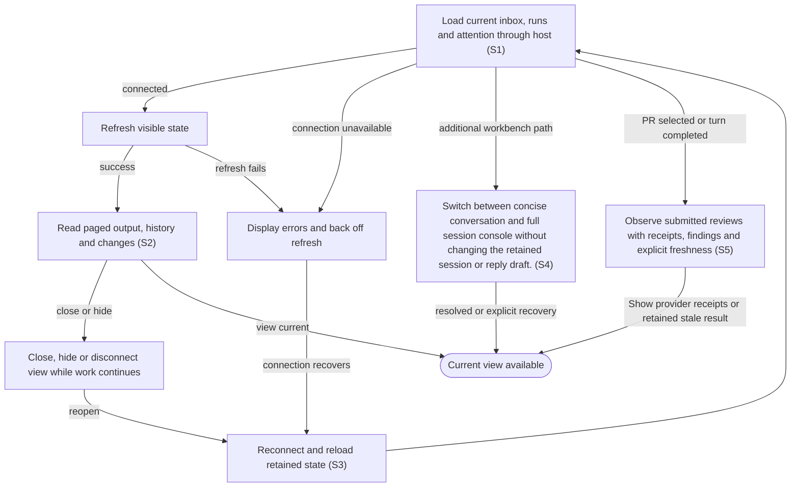

# View live status, transcript and changes across reconnects

## Goal

The owner follows work from the embedded application and can return to it without losing progress.

## Preconditions

A supported host has opened the connected application. Updated embedded application content is advertised with a new identity so the host can distinguish it from an older cached view.

## Main flow

1. Load the inbox as a full-width list beneath compact navigation. Opening an item or agent replaces the list with one focused page; owned surfaces preserve the active host theme even when the surrounding document is transparent.
2. Refresh visible state as work changes and display connection errors when refresh fails.
3. Read output and file changes incrementally, with progress/status messages, final replies, user messages and readable errors visible; plans, diffs, command output and internal summaries remain under collapsed Details or the optional same-session console; load older history on request.
4. Close or reconnect the view and reload retained state.
5. For a pull request, read posted reviews above the conversation: open the GitHub receipt, inspect the author, verdict, reviewed commit, body and inline findings, and distinguish current-head from earlier-head reviews. Review observations include all authors and do not imply that a particular run published them.

## Alternatives and recovery

Hidden or disconnected views back off refreshes. Failed initialization does not poison the open view: later attempts use a fresh connection. Only known reads retry bounded transient transport failures; business/tool errors remain distinct. Recovered polling clears its own connection feedback, while transcript reads clear only their local read failures. Existing output and drafts remain visible. A healthy background read never dismisses an uncertain action response, and Start, Send, answers and saves are not automatically replayed. The view uses the host connection and receives no local credentials. Closing the view leaves agents running. Transcript output and diffs are paged rather than loaded without bounds. Ordinary relationship and message drafts survive tab/record changes within the open app; closing/reloading ends that draft lifetime. Branding, permanent footer and successful sync timestamps are omitted. Connected status is available to assistive technology; connecting/disconnected feedback and failures remain visible. Back restores list context and nonempty history remains disclosed. Settings opens in an independent view using the same authenticated connection; saving configuration leaves an already-open task view and its drafts intact.

## Scenarios

- **S1** Embedded view communicates through the host connection without direct local-service requests.
- **S2** Incremental state and paged transcript preserve older history without losing concurrent changes. Saved prepared proposals from another connected view appear without manually reloading or starting work. A previous empty refresh result cannot freeze later updates; retained status reflects completed actions even when the host reuses identical read responses.
- **S3** Reopening a view retains pending attention and live work; hidden/disconnected refreshes back off.

Conversation rendering keeps human-facing agent messages and your replies visible. Technical activity remains under Details, with structured error data there and the readable error message visible. Streaming updates preserve that distinction; a technical-only active stream shows a concise waiting status. Pending questions and approvals remain actionable outside Details.

- **S4** Switch between concise conversation and full session console without changing the retained session or reply draft.

Automatic recovery exchanges appear as technical activity under Details or in the session console. Your responses keep their ordinary conversation role.

- **S5** Submitted reviews refresh after a PR turn and remain available to plugin skills with provider receipt URLs and explicit freshness. A failed refresh retains saved reviews and the last successful observation; an unverified result is not an empty or successful publication result. Reading, refreshing and opening review links never starts work or repeats publication.

<!-- flow-references -->
## Terminology and UI references

Glossary: [host](../glossary/README.md#host), [inbox](../glossary/README.md#inbox), [agent-run](../glossary/README.md#agent-run), [transcript](../glossary/README.md#transcript), [coverage-gap](../glossary/README.md#coverage-gap), [unverified-behavior](../glossary/README.md#unverified-behavior), [session-console](../glossary/README.md#session-console), [published-review](../glossary/README.md#published-review).
UI entities: [S-FACTORY](../ui/README.md#S-FACTORY), [PAGE-INBOX](../ui/README.md#PAGE-INBOX), [PAGE-AGENTS](../ui/README.md#PAGE-AGENTS), [PAGE-SETTINGS](../ui/README.md#PAGE-SETTINGS), [P-IDENTITY](../ui/README.md#P-IDENTITY), [P-NAVIGATION](../ui/README.md#P-NAVIGATION), [P-FEEDBACK](../ui/README.md#P-FEEDBACK), [W-IDENTITY](../ui/README.md#W-IDENTITY), [W-NAVIGATION](../ui/README.md#W-NAVIGATION), [W-GLOBAL-ERROR](../ui/README.md#W-GLOBAL-ERROR), [W-CONNECTION-BLOCKER](../ui/README.md#W-CONNECTION-BLOCKER), [C-NAVIGATE](../ui/README.md#C-NAVIGATE), [C-STATE-REFRESH](../ui/README.md#C-STATE-REFRESH), [C-GLOBAL-ATTENTION](../ui/README.md#C-GLOBAL-ATTENTION), [W-TRANSCRIPT](../ui/README.md#W-TRANSCRIPT), [W-MESSAGE](../ui/README.md#W-MESSAGE), [C-TRANSCRIPT](../ui/README.md#C-TRANSCRIPT), [C-FOLLOW-UP](../ui/README.md#C-FOLLOW-UP), [PAGE-AGENT](../ui/README.md#PAGE-AGENT), [C-BACK](../ui/README.md#C-BACK), [S-SETTINGS](../ui/README.md#S-SETTINGS), [C-OPEN-SETTINGS](../ui/README.md#C-OPEN-SETTINGS), [W-SESSION-CONSOLE](../ui/README.md#W-SESSION-CONSOLE), [C-SESSION-CONSOLE](../ui/README.md#C-SESSION-CONSOLE), [W-PR-EVIDENCE](../ui/README.md#W-PR-EVIDENCE).

## Flow diagram

## Implementation references

- [web/src/main.tsx](../../web/src/main.tsx) — Visible polling, transcript rendering and retained selections (`function Factory(`)
- [web/src/bridge.ts](../../web/src/bridge.ts) — Host-only app bridge
- [internal/transport/mcp.go](../../internal/transport/mcp.go) — Snapshots, incremental changes and transcript tools (`func (s *Server) snapshot(`)
- [internal/store/store.go](../../internal/store/store.go) — Bounded event and transcript pagination
- [internal/domain/types.go](../../internal/domain/types.go) — Shared domain, persistence, transport or dependency contract
- [go.mod](../../go.mod) — Shared domain, persistence, transport or dependency contract
- [go.sum](../../go.sum) — Shared domain, persistence, transport or dependency contract
- [web/src/types.ts](../../web/src/types.ts) — Embedded UI build and host-fixture configuration
- [web/src/style.css](../../web/src/style.css) — Owned themed body/root/main backgrounds preserve the embedded surface when host styling makes html transparent.
- [web/package.json](../../web/package.json) — Embedded UI build and host-fixture configuration
- [web/package-lock.json](../../web/package-lock.json) — Embedded UI build and host-fixture configuration
- [web/tsconfig.json](../../web/tsconfig.json) — Embedded UI build and host-fixture configuration
- [web/vite.config.ts](../../web/vite.config.ts) — Embedded UI build and host-fixture configuration
- [web/index.html](../../web/index.html) — Embedded UI build and host-fixture configuration
- [web/playwright.config.ts](../../web/playwright.config.ts) — Embedded UI build and host-fixture configuration
- [internal/testhost/main.go](../../internal/testhost/main.go) — Embedded UI build and host-fixture configuration
- [internal/testutil/fakecodex/main.go](../../internal/testutil/fakecodex/main.go) — Embedded UI build and host-fixture configuration
- [internal/testutil/testutil.go](../../internal/testutil/testutil.go) — Embedded UI build and host-fixture configuration
- [internal/web/embed.go](../../internal/web/embed.go) — Embedded UI build and host-fixture configuration
- [internal/transport/mcp.go](../../internal/transport/mcp.go) — Advertises the embedded UI under a full-content SHA256 URI and binds all tool/output-template references to it, retaining only an unadvertised exact legacy-read alias. (`func registerUIResource(`)
- [internal/web/embed.go](../../internal/web/embed.go) — Configuration opens through its own bridged document entry. (`func SettingsHTML(`)
- [web/src/reviews.tsx](../../web/src/reviews.tsx) — Visible submitted review receipts, verdict/head, inline findings, cached freshness and host links. (`export function PostedReviews(`)
- [internal/app/review_publication.go](../../internal/app/review_publication.go) — Durable budgeted review observations, failure retention and post-turn refresh. (`func (a *App) ReadPRReviews(`)
- [internal/providers/github_reviews.go](../../internal/providers/github_reviews.go) — Read submitted review and inline-comment pages; omit pending drafts. (`func (g *GitHub) PublishedReviews(`)

## Test references

- [web/tests/factory.spec.ts](../../web/tests/factory.spec.ts) — `test("MCP bridge drives the assembled daemon through launch, question, answer and follow-up"`; S1. Assembled app rejects direct iframe daemon requests.
- [internal/app/app_test.go](../../internal/app/app_test.go) — `func TestAgentQuestionExactlyOnceAndRecovery(`; S2. Transcript pagination exposes more history.
- [web/tests/factory.spec.ts](../../web/tests/factory.spec.ts) — `test("triage does not launch, launch edits and attention answer survive reopening"`; S3. Controlled-host fixture reloads host and iframe with a question pending, reopens the original waiting run and choices, answers the original request once and follows up without another launch.
- [internal/transport/mcp_test.go](../../internal/transport/mcp_test.go) — `func TestAuthenticatedMCPDiscoveryToolsAndUI(`; S1, S2. Authenticated tools/resources and discovery fixture.
- [web/tests/factory.spec.ts](../../web/tests/factory.spec.ts) — `test(`Axe WCAG A/AA scans the owned app iframe across core states in ${theme} theme``; S1. Late host-transparent html is reproduced in both themes; computed body/root/main backgrounds stay theme-owned and fourteen scoped Axe scans require zero automated violations. Does not establish full/manual/installed-host accessibility.
- [internal/transport/ui_resource_test.go](../../internal/transport/ui_resource_test.go) — `func TestUIResourceContentIdentityAndCompatibility(`; S1. Actual SDK fixture asserts stable same-content and changed-content UI identity, matching current tool/resource metadata and exact HTML; only the original exact URI reads current content unadvertised, while unknown/previous hashes and query variants reject. CSP domains stay empty. This does not prove host refresh or installed UI acceptance.
- [web/tests/factory.spec.ts](../../web/tests/factory.spec.ts) — `test("Open agent targets the newest retained run and keeps message drafts across tabs and runs"`; S3. Open-app per-run message drafts survive run/tab changes, distinct from reload persistence.
- [web/tests/factory.spec.ts](../../web/tests/factory.spec.ts) — `agent conversation shows human messages and keeps technical activity under Details`; S2. Human progress/final/user/error messages stay visible; technical activity is one secondary disclosure, live updates preserve the distinction and questions remain actionable.
- [web/tests/factory.spec.ts](../../web/tests/factory.spec.ts) — `single-page navigation preserves list context and drafts at`; S3. Both themes and 1280px/390px widths assert exclusive list/item/agent pages, Back focus/scroll/query restoration and per-record draft preservation.
- [web/tests/factory.spec.ts](../../web/tests/factory.spec.ts) — `separate settings can save while the inbox view retains its item and agent drafts`; S3. Both surfaces remain open independently while shared data refreshes.
- [web/tests/factory.spec.ts](../../web/tests/factory.spec.ts) — `initial bridge failures retry a fresh handshake without reloading or losing state`; S1, S3. Three failed SDK initializations recover through four fresh handshakes with one successful initial snapshot and no stale banner.
- [web/tests/factory.spec.ts](../../web/tests/factory.spec.ts) — `transient polling outage recovers without a stale error banner or lost first message`; S1, S3. A real SDK JSON-RPC connection fault drives reconnect feedback; healthy reads clear it and preserve the first-message draft with no mutation.
- [web/tests/factory.spec.ts](../../web/tests/factory.spec.ts) — `transcript recovery keeps output and draft while removing only its own read error`; S1, S3. After transcript transport failures, previous output and follow-up draft remain and only the local read error disappears on recovery.
- [web/tests/factory.spec.ts](../../web/tests/factory.spec.ts) — `exact host-wrapped MCP connection error retries a read without exposing its framework text`; S1. Known host-wrapped transport failures recover on reads without framework banners, and mutations remain one attempt.
- [web/tests/factory.spec.ts](../../web/tests/factory.spec.ts) — `exact host-wrapped connection failure never replays a mutation`; S1. Known host-wrapped transport failures recover on reads without framework banners, and mutations remain one attempt.
- [web/tests/factory.spec.ts](../../web/tests/factory.spec.ts) — `technical-only activity leaves a concise waiting state in the conversation`; S1. Technical-only work does not flood the normal conversation; status and pending attention remain available.
- [web/tests/factory.spec.ts](../../web/tests/factory.spec.ts) — `text fallback opens the same session console`; S4. Presentation switch reveals technical output and preserves the same draft and session.
- [internal/app/review_requests_test.go](../../internal/app/review_requests_test.go) — `func TestPreparePRReviewResolvesDefaultsAndStartsOnlyExplicitly(`; S2. Each preparation advances the incremental event cursor with its own prepared run, while retaining no workspace/thread before explicit Start.
- [web/tests/factory.spec.ts](../../web/tests/factory.spec.ts) — `test("fresh read markers observe external changes after a host memoizes an empty journal page"`; S2, S3. Host memoizes identical reads after empty journal response; two external changes still appear without reload, launch or message, using distinct read markers.
- [internal/app/review_publication_test.go](../../internal/app/review_publication_test.go) — `func TestPostedReviewsRefreshAfterTurnAndRetainReceiptsOnFailure(`; S5. Completed PR turns refresh actual GitHub receipts; repeated reads respect cadence; failure and pause retain successful receipts and freshness; issues reject.
- [internal/providers/github_reviews_test.go](../../internal/providers/github_reviews_test.go) — `func TestPublishedReviewsKeepVerdictCommitAndPaginatedInlineEvidence(`; S5. Read-only authenticated pagination preserves verdict, author, commit, body and correctly grouped inline comments; pending drafts are excluded.
- [web/tests/factory.spec.ts](../../web/tests/factory.spec.ts) — `posted reviews show verified verdicts findings and refresh after completion`; S5. Both narrow themes expose receipts/verdicts/current or earlier commits/body/inline comments, unverified and stale states; snapshot version refresh, host links and manual refresh launch no work; scoped Axe passes.
- [internal/transport/mcp_test.go](../../internal/transport/mcp_test.go) — `func TestAuthenticatedMCPDiscoveryToolsAndUI(`; S5. Model/app discovery exposes read_pr_reviews; authenticated read_pr_reviews/read_run preserve receipt URL, reviewed head and inline findings.

## Verification and gaps

Local suites: `go`, `browser`.
Fixture success does not establish real-host acceptance.
- **S2** — `gap-flow-view-live-work-s2-01` · Unverified behavior · P2 · owner: user-flow-maintainer. Concurrent snapshot/cursor ordering and large diff pagination need focused tests. Next verification: Add concurrent snapshot/cursor ordering and multi-page large-diff fixture cases that assert no missed, repeated or reordered retained events.
- **S3** — `gap-flow-view-live-work-s3-01` · Unverified behavior · P1 · owner: specification-coordinator. The actual final-build connected one-hour interval passed in ../acceptance.md. Hidden/disconnected visibility timing and backoff transitions still lack focused assertions; reconnect/iframe fixtures and a stable connected soak do not prove those variants. Next verification: Exercise hidden/disconnected visibility and retry-backoff transitions with focused fixture assertions, and retain the completed installed-build soak as bounded dated evidence rather than indefinite-availability proof.

<!-- /flow-references -->
