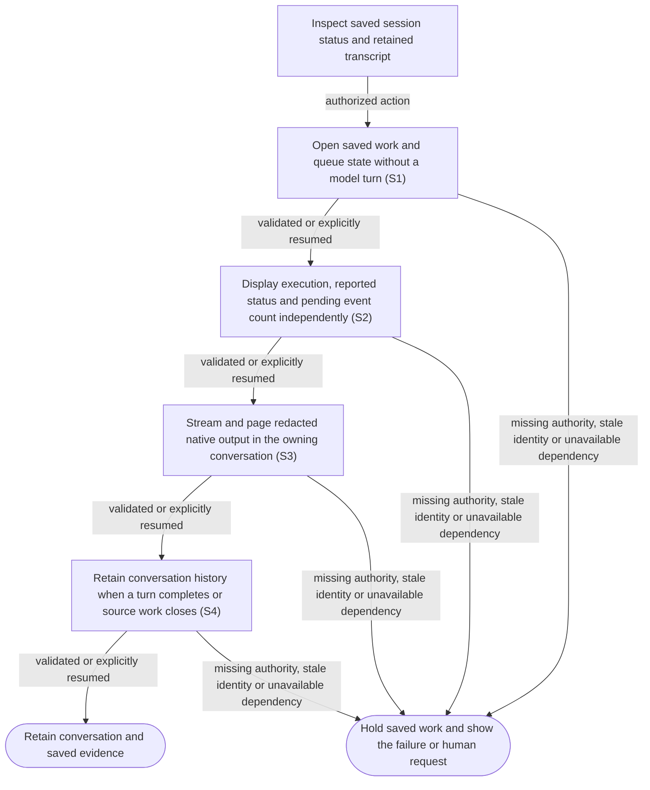

# Inspect saved session status and retained transcript

## Goal

Inspect saved session status and retained transcript.

## Preconditions

The private owner connection is established. Application data starts clean in the session-state database; native Codex authentication and configuration remain outside application state. GitHub source text is task data, not new authority.

## Main flow

1. Open saved work and queue state without a model turn.

2. Display execution, reported status and pending event count independently.

   Blocked and answered transitions notify the owning session subscription without
   including question or answer text. Answering one request keeps reported status
   blocked while another explicit status request remains; native blocking requests
   independently keep execution waiting.

3. Stream and page redacted native output in the owning conversation.

4. Retain conversation history when a turn completes or source work closes.

## Alternatives and recovery

Read-only inspection does not launch a model turn. Surface validation or provider errors and retain saved work. Human questions, explicit interruptions and uncertain deliveries hold automatic dispatch. Resume against current retained history; never replay an uncertain send or an answered RPC blindly. Explicit cleanup preserves dirty worktrees.

## Scenarios

- **S1** — Open saved work and queue state without a model turn.
- **S2** — Display execution, reported status and pending event count independently.
- **S3** — Stream and page redacted native output in the owning conversation.
- **S4** — Retain conversation history when a turn completes or source work closes.

## Verification scope

The assertion references below establish their fixture scope. Native installed-host, real-provider and assistive-technology acceptance require separate dated observations. The retired pipeline editor, review artifacts, AI question repair and built-in issue-report ledger have no compatibility path.

<!-- flow-references -->
## Terminology and UI references

Glossary: [retained-session](../glossary/README.md#retained-session), [execution-state](../glossary/README.md#execution-state), [reported-work-status](../glossary/README.md#reported-work-status).
UI entities: [S-FACTORY](../ui/README.md#S-FACTORY), [W-TRANSCRIPT](../ui/README.md#W-TRANSCRIPT), [W-WORK-STATUS](../ui/README.md#W-WORK-STATUS), [W-EVENT-BATCHES](../ui/README.md#W-EVENT-BATCHES).

## Flow diagram

## Implementation references

- [web/src/wrapper.tsx](../../web/src/wrapper.tsx) — Saved inbox, session conversation, human input and confirmed configuration. (`function Factory(`)
- [internal/transport/factory.go](../../internal/transport/factory.go) — Session, configuration, event and retained triage APIs. (`func NewFactory(`)
- [internal/factory/requests.go](../../internal/factory/requests.go) — Exact session-bound native requests and explicit status, without classifiers. (`func (s *Service) Answer(`)
- [internal/factory/service.go](../../internal/factory/service.go) — Durable canonical sessions, event queue, quiet clock and delivery claims. (`func (s *Service) Chat(`)
- [internal/testhost/main.go](../../internal/testhost/main.go) — Current view-live-work implementation or fixture/build dependency.
- [internal/testhost/performance.go](../../internal/testhost/performance.go) — Current view-live-work implementation or fixture/build dependency.
- [web/fixture-ports.ts](../../web/fixture-ports.ts) — Current view-live-work implementation or fixture/build dependency.
- [web/package-lock.json](../../web/package-lock.json) — Current view-live-work implementation or fixture/build dependency.
- [web/package.json](../../web/package.json) — Current view-live-work implementation or fixture/build dependency.
- [web/playwright.performance.config.ts](../../web/playwright.performance.config.ts) — Current view-live-work implementation or fixture/build dependency.
- [web/vite.config.ts](../../web/vite.config.ts) — Current view-live-work implementation or fixture/build dependency.
- [web/tsconfig.json](../../web/tsconfig.json) — Current view-live-work implementation or fixture/build dependency.
- [web/playwright.config.ts](../../web/playwright.config.ts) — Current view-live-work implementation or fixture/build dependency.
- [internal/transport/factory_projection.go](../../internal/transport/factory_projection.go) — Bounded view-specific bodyless inbox and compact session/question state; source detail and configuration are separate. (`func factoryState(`)
- [internal/store/snapshot.go](../../internal/store/snapshot.go) — Durable metadata-only UI change cursor supports unchanged state reads without transcript-driven rebuilding. (`func (s *Store) UILatest(`)

## Test references

- [web/tests/wrapper.spec.ts](../../web/tests/wrapper.spec.ts) — `opening an issue or PR does not create or flush a session`; S1. Opening saved issue and PR detail sends no session mutation.
- [web/tests/wrapper.spec.ts](../../web/tests/wrapper.spec.ts) — `execution reported status and pending events stay separate`; S2. Execution idle, reported done and pending event count render independently.
- [web/tests/assembled.spec.ts](../../web/tests/assembled.spec.ts) — `assembled native session retains thread across question answer and follow-up`; S3. Real MCP daemon and fake native subprocess carry exact native answer and follow-up in retained conversation.
- [internal/factory/service_test.go](../../internal/factory/service_test.go) — `func TestSecretAnswerRedactsSplitStreamingAndRetainedOutput(`; S3. Secret answers redact split deltas, completed output and echoed native request options in persisted records; fresh-service retained-thread resume reloads vault redactions for new completed output.
- [internal/factory/service_test.go](../../internal/factory/service_test.go) — `func TestRepositoryQuietOverrideAndIdleWithoutStatus(`; S4. Repository quiet override, completion without report, and source closure retain history.
- [internal/transport/ui_resource_test.go](../../internal/transport/ui_resource_test.go) — `func TestUIResourceContentIdentityAndUnknownURI(`; S1. Current view-live-work fixture assertion TestUIResourceContentIdentityAndUnknownURI. Inspect its exact assertion scope.
- [internal/transport/ui_resource_test.go](../../internal/transport/ui_resource_test.go) — `func TestSettingsResourceIsIndependentFromInbox(`; S1. Current view-live-work fixture assertion TestSettingsResourceIsIndependentFromInbox. Inspect its exact assertion scope.
- [web/performance/tests/launch.spec.ts](../../web/performance/tests/launch.spec.ts) — `test("production embedded direct launch: every fresh and warm sample is at most 100 ms`; S1. Current view-live-work fixture assertion production embedded direct launch: every fresh and warm sample is at most 100 ms. Inspect its exact assertion scope.
- [internal/web/embed_test.go](../../internal/web/embed_test.go) — `func TestSettingsDocumentHasIndependentEntry(`; S1. Current view-live-work fixture assertion TestSettingsDocumentHasIndependentEntry. Inspect its exact assertion scope.
- [internal/web/embed_test.go](../../internal/web/embed_test.go) — `func TestProductionShellPrecedesDeferredRuntime(`; S1. Current view-live-work fixture assertion TestProductionShellPrecedesDeferredRuntime. Inspect its exact assertion scope.
- [web/tests/wrapper-fixtures.ts](../../web/tests/wrapper-fixtures.ts) — `export async function host(`; S1. Fixture MCP host dependency for the named browser assertions; helper presence alone claims no behavior coverage.
- [internal/transport/fixture_test.go](../../internal/transport/fixture_test.go) — `func newTrackingFixture(`; S1. Authenticated native-session MCP fixture for API logging assertions; not standalone scenario evidence.
- [web/tests/wrapper.spec.ts](../../web/tests/wrapper.spec.ts) — `streamed output and its completed message render once`; S3. Matching streamed and completed agent text appears once while distinct final messages remain visible.
- [web/tests/wrapper.spec.ts](../../web/tests/wrapper.spec.ts) — `failed second selection never pairs old context with new actions`; S1. Rejected detail B clears prior detail A; B title and disabled send prevent actions on mismatched saved context.
- [internal/transport/factory_test.go](../../internal/transport/factory_test.go) — `func TestFactoryStatePagesCompactDataAndExplicitDelivery(`; S1, S2. A thousand large saved sources yield bounded bodyless pages; body search/filter precede paging, queue state is explicit, historical questions/proposals are bounded, and full source requires detail read.
- [web/tests/wrapper.spec.ts](../../web/tests/wrapper.spec.ts) — `same-item source and relationship versions refresh and Back reopens saved detail`; S1. Saved source revision and relationship version changes reload the same selected detail; Back and reopening request fresh detail.
- [web/tests/wrapper.spec.ts](../../web/tests/wrapper.spec.ts) — `retained transcript drains available pages without polling delays`; S3. Twelve available history pages of 100 events reach the latest row within five seconds, retain at most 1,000 rows and request exact advancing cursors.
- [web/tests/wrapper.spec.ts](../../web/tests/wrapper.spec.ts) — `fragmented transcript waits for complete ordered sets across pages`; S3. A page-spanning fragmented completion reconstructs Unicode, quotes and controls exactly, preserves a distinct complete message, and never renders an incomplete tail.
- [internal/transport/factory_test.go](../../internal/transport/factory_test.go) — `func TestFactoryItemReadsRequireDisplayedRevisionAcknowledgmentAndVersions(`; S1. Detail fetch has no read mutation; source and relationship changes alter matching detail versions; stale acknowledgment leaves the current revision unread until its explicit exact acknowledgment.
- [internal/factory/regressions_test.go](../../internal/factory/regressions_test.go) — `func TestCompletedOutputKeepsAgentMessagesAndByteBounds(`; S3. Non-agent completions add no output journal rows; large agent completion rows stay byte-bounded and reassemble the exact message ID and text.
- [internal/store/factory_reads_test.go](../../internal/store/factory_reads_test.go) — `func TestSessionOutputFragmentsBoundRowsAndPreserveExactJSON(`; S3. Every fragment row is valid UTF8 and at most 32 KiB, paged output is bounded, and ordered fragments reconstruct the exact Unicode/control/quote JSON.
- [web/tests/wrapper.spec.ts](../../web/tests/wrapper.spec.ts) — `idle state polls use change versions and mutations refresh without losing the view`; S1, S2. Idle polls carry sinceVersion and preserve the accepted view through unchanged responses; saved mutations produce a new view and tab/search transitions omit the old cursor.
- [web/tests/wrapper.spec.ts](../../web/tests/wrapper.spec.ts) — `a delayed state version cannot replace a newer accepted refresh`; S1, S2. After a held older full response is consumed, its first successor poll retains the newer accepted version cursor; current rows remain visible and delayed stale rows stay absent.
- [internal/factory/regressions_test.go](../../internal/factory/regressions_test.go) — `func TestNativeStreamUsesCompactIdentityAndPreservesQueuedContexts(`; S3. Fifty deltas preserve 20 queued contexts of 100 KiB each; runtime rows stay within 512 bytes with pendingCount 20 and no pending payload, accept an opaque queue sentinel, leave the UI cursor unchanged and reject stale epochs.
- [internal/store/factory_reads_test.go](../../internal/store/factory_reads_test.go) — `func TestSessionRuntimeProjectionIsAtomicForPutCASDeleteAndRollback(`; S3. Compact runtime epoch/thread identity follows session Put/CAS/delete atomically; rollback and failed CAS preserve the prior identity.
- [internal/transport/factory_test.go](../../internal/transport/factory_test.go) — `func TestFactoryStateVersionSkipsIdleProjectionAndTracksMetadata(`; S1, S2. An unchanged cursor returns only version/unchanged before decoding an intentionally invalid source; metadata writes advance the cursor, live deletion refreshes and transcript output does not invalidate state.
- [internal/factory/review6_test.go](../../internal/factory/review6_test.go) — `func TestRetainedRefreshCannotOverwriteConcurrentWebhook(`; S2. An in-flight retained PR refresh cannot replace a newer webhook row on either success or provider failure: current head/body/discussion/CI and automatic links remain, and actual batch/native input agrees.
- [internal/factory/review6_test.go](../../internal/factory/review6_test.go) — `func TestBlockedAndAnsweredTransitionsEmitSessionSubscription(`; S2. An exact session.changed webhook subscriber receives one blocked and one answered transition; notifications contain neither question nor answer text.
- [internal/factory/review6_test.go](../../internal/factory/review6_test.go) — `func TestAnswerPreservesOtherExplicitBlockedRequests(`; S2. For blocking and nonblocking native input, an invalid answer fails; valid native and first explicit-status answers retain blocked/waiting while a second explicit status question remains. Only the final answer yields working/running.
- [internal/transport/factory_test.go](../../internal/transport/factory_test.go) — `func TestFactoryStateReusesInboxAcrossQueriesAndRefreshesAfterMutation(`; S1. After warming the derived inbox, a raw SQL sentinel makes any repeated full decode fail. Changed filter/page/search/tab and conversation queries still succeed from the retained projection; an ordinary source mutation invalidates the cache and returns the updated title.

## Verification and gaps

Local suites: `go`, `browser`, `ui-performance`.
Fixture success does not establish real-host acceptance.
- **S3** — `gap-flow-view-live-work-s3-01` · Unverified behavior · P1 · owner: specification-coordinator. No installed-host connected one-hour soak is established by this development port. Hidden/disconnected visibility timing and backoff transitions also lack focused assertions; reconnect/iframe fixtures do not prove those variants. Next verification: Exercise hidden/disconnected visibility and retry-backoff transitions with focused fixture assertions, then record a connected one-hour soak for the actual installed port version as bounded dated evidence.

<!-- /flow-references -->
