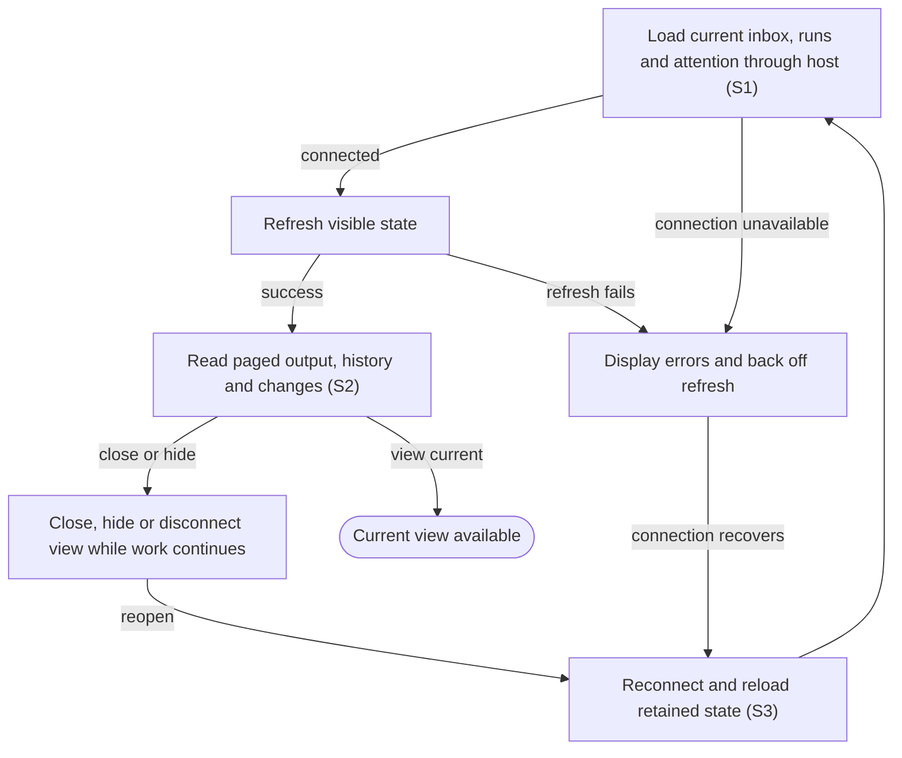

# View live status, transcript and changes across reconnects

## Goal

The owner follows work from the embedded application and can return to it without losing progress.

## Preconditions

A supported host has opened the connected application. Updated embedded application content is advertised with a new identity so the host can distinguish it from an older cached view.

## Main flow

1. Load the current inbox, runs and attention state on an application surface that preserves the active host theme even when the surrounding host document is transparent.
2. Refresh visible state as work changes and display connection errors when refresh fails.
3. Read output and file changes incrementally, loading older history on request.
4. Close or reconnect the view and reload retained state.

## Alternatives and recovery

Hidden or disconnected views back off refreshes. The view uses the host connection and receives no local credentials. Closing the view leaves agents running. Transcript output and diffs are paged rather than loaded without bounds.

## Scenarios

- **S1** Embedded view communicates through the host connection without direct local-service requests.
- **S2** Incremental state and paged transcript preserve older history without losing concurrent changes.
- **S3** Reopening a view retains pending attention and live work; hidden/disconnected refreshes back off.

<!-- flow-references -->
## Terminology and UI references

Glossary: [host](../glossary/README.md#host), [inbox](../glossary/README.md#inbox), [agent-run](../glossary/README.md#agent-run), [transcript](../glossary/README.md#transcript), [coverage-gap](../glossary/README.md#coverage-gap), [unverified-behavior](../glossary/README.md#unverified-behavior).
UI entities: [S-FACTORY](../ui/README.md#S-FACTORY), [PAGE-INBOX](../ui/README.md#PAGE-INBOX), [PAGE-AGENTS](../ui/README.md#PAGE-AGENTS), [PAGE-SETTINGS](../ui/README.md#PAGE-SETTINGS), [P-IDENTITY](../ui/README.md#P-IDENTITY), [P-NAVIGATION](../ui/README.md#P-NAVIGATION), [P-FEEDBACK](../ui/README.md#P-FEEDBACK), [P-CONTINUITY](../ui/README.md#P-CONTINUITY), [W-IDENTITY](../ui/README.md#W-IDENTITY), [W-NAVIGATION](../ui/README.md#W-NAVIGATION), [W-GLOBAL-ERROR](../ui/README.md#W-GLOBAL-ERROR), [W-CONNECTION-BLOCKER](../ui/README.md#W-CONNECTION-BLOCKER), [W-CONTINUITY-NOTICE](../ui/README.md#W-CONTINUITY-NOTICE), [C-NAVIGATE](../ui/README.md#C-NAVIGATE), [C-STATE-REFRESH](../ui/README.md#C-STATE-REFRESH), [C-GLOBAL-ATTENTION](../ui/README.md#C-GLOBAL-ATTENTION), [W-TRANSCRIPT](../ui/README.md#W-TRANSCRIPT), [W-MESSAGE](../ui/README.md#W-MESSAGE), [C-TRANSCRIPT](../ui/README.md#C-TRANSCRIPT), [C-FOLLOW-UP](../ui/README.md#C-FOLLOW-UP).

## Flow diagram

## Implementation references

- [web/src/main.tsx](../../web/src/main.tsx) — Visible polling, transcript rendering and retained selections (`function Factory(`)
- [web/src/bridge.ts](../../web/src/bridge.ts) — Host-only app bridge
- [internal/transport/mcp.go](../../internal/transport/mcp.go) — Snapshots, incremental changes and transcript tools (`func (s *Server) snapshot(`)
- [internal/store/store.go](../../internal/store/store.go) — Bounded event and transcript pagination
- [internal/domain/types.go](../../internal/domain/types.go) — Shared domain, persistence, transport or dependency contract
- [go.mod](../../go.mod) — Shared domain, persistence, transport or dependency contract
- [go.sum](../../go.sum) — Shared domain, persistence, transport or dependency contract
- [web/src/types.ts](../../web/src/types.ts) — Embedded UI build and host-fixture configuration
- [web/src/style.css](../../web/src/style.css) — Owned themed body/root/main backgrounds preserve the embedded surface when host styling makes html transparent.
- [web/package.json](../../web/package.json) — Embedded UI build and host-fixture configuration
- [web/package-lock.json](../../web/package-lock.json) — Embedded UI build and host-fixture configuration
- [web/tsconfig.json](../../web/tsconfig.json) — Embedded UI build and host-fixture configuration
- [web/vite.config.ts](../../web/vite.config.ts) — Embedded UI build and host-fixture configuration
- [web/index.html](../../web/index.html) — Embedded UI build and host-fixture configuration
- [web/playwright.config.ts](../../web/playwright.config.ts) — Embedded UI build and host-fixture configuration
- [internal/testhost/main.go](../../internal/testhost/main.go) — Embedded UI build and host-fixture configuration
- [internal/testutil/fakecodex/main.go](../../internal/testutil/fakecodex/main.go) — Embedded UI build and host-fixture configuration
- [internal/testutil/testutil.go](../../internal/testutil/testutil.go) — Embedded UI build and host-fixture configuration
- [internal/web/embed.go](../../internal/web/embed.go) — Embedded UI build and host-fixture configuration
- [internal/transport/mcp.go](../../internal/transport/mcp.go) — Advertises the embedded UI under a full-content SHA256 URI and binds all tool/output-template references to it, retaining only an unadvertised exact legacy-read alias. (`func registerUIResource(`)

## Test references

- [web/tests/factory.spec.ts](../../web/tests/factory.spec.ts) — `test("MCP bridge drives the assembled daemon through launch, question, answer and follow-up"`; S1. Assembled app rejects direct iframe daemon requests.
- [internal/app/app_test.go](../../internal/app/app_test.go) — `func TestAgentQuestionExactlyOnceAndRecovery(`; S2. Transcript pagination exposes more history.
- [web/tests/factory.spec.ts](../../web/tests/factory.spec.ts) — `test("triage does not launch, launch edits and attention answer survive reopening"`; S3. Controlled-host fixture reloads host and iframe with a question pending, reopens the original waiting run and choices, answers the original request once and follows up without another launch.
- [internal/transport/mcp_test.go](../../internal/transport/mcp_test.go) — `func TestAuthenticatedMCPDiscoveryToolsAndUI(`; S1, S2. Authenticated tools/resources and discovery fixture.
- [web/tests/factory.spec.ts](../../web/tests/factory.spec.ts) — `test(`Axe WCAG A/AA scans the owned app iframe across core states in ${theme} theme``; S1. Late host-transparent html is reproduced in both themes; computed body/root/main backgrounds stay theme-owned and fourteen scoped Axe scans require zero automated violations. Does not establish full/manual/installed-host accessibility.
- [internal/transport/ui_resource_test.go](../../internal/transport/ui_resource_test.go) — `func TestUIResourceContentIdentityAndCompatibility(`; S1. Actual SDK fixture asserts stable same-content and changed-content UI identity, matching current tool/resource metadata and exact HTML; only the original exact URI reads current content unadvertised, while unknown/previous hashes and query variants reject. CSP domains stay empty. This does not prove host refresh or installed UI acceptance.

## Verification and gaps

Local suites: `go`, `browser`.
Fixture success does not establish real-host acceptance.
- **S2** — `gap-flow-view-live-work-s2-01` · Unverified behavior · P2 · owner: user-flow-maintainer. Concurrent snapshot/cursor ordering and large diff pagination need focused tests. Next verification: Add concurrent snapshot/cursor ordering and multi-page large-diff fixture cases that assert no missed, repeated or reordered retained events.
- **S3** — `gap-flow-view-live-work-s3-01` · Unverified behavior · P1 · owner: specification-coordinator. The actual final-build connected one-hour interval passed in ../acceptance.md. Hidden/disconnected visibility timing and backoff transitions still lack focused assertions; reconnect/iframe fixtures and a stable connected soak do not prove those variants. Next verification: Exercise hidden/disconnected visibility and retry-backoff transitions with focused fixture assertions, and retain the completed installed-build soak as bounded dated evidence rather than indefinite-availability proof.

<!-- /flow-references -->
